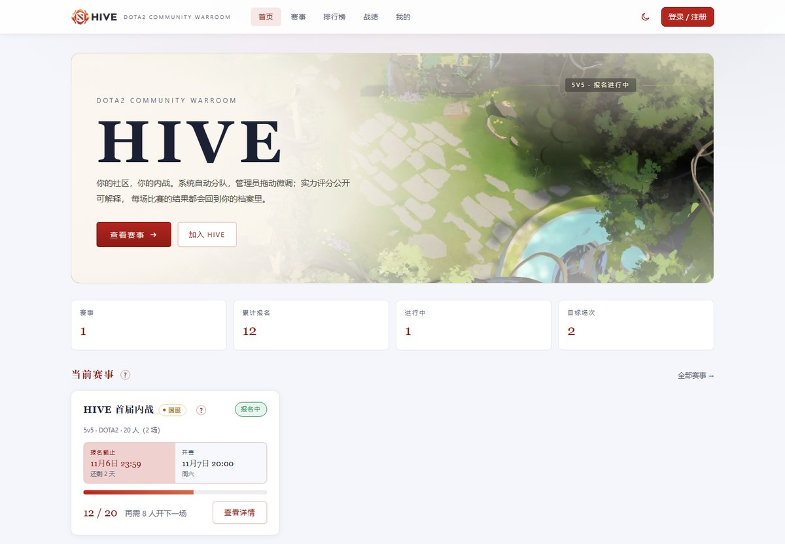
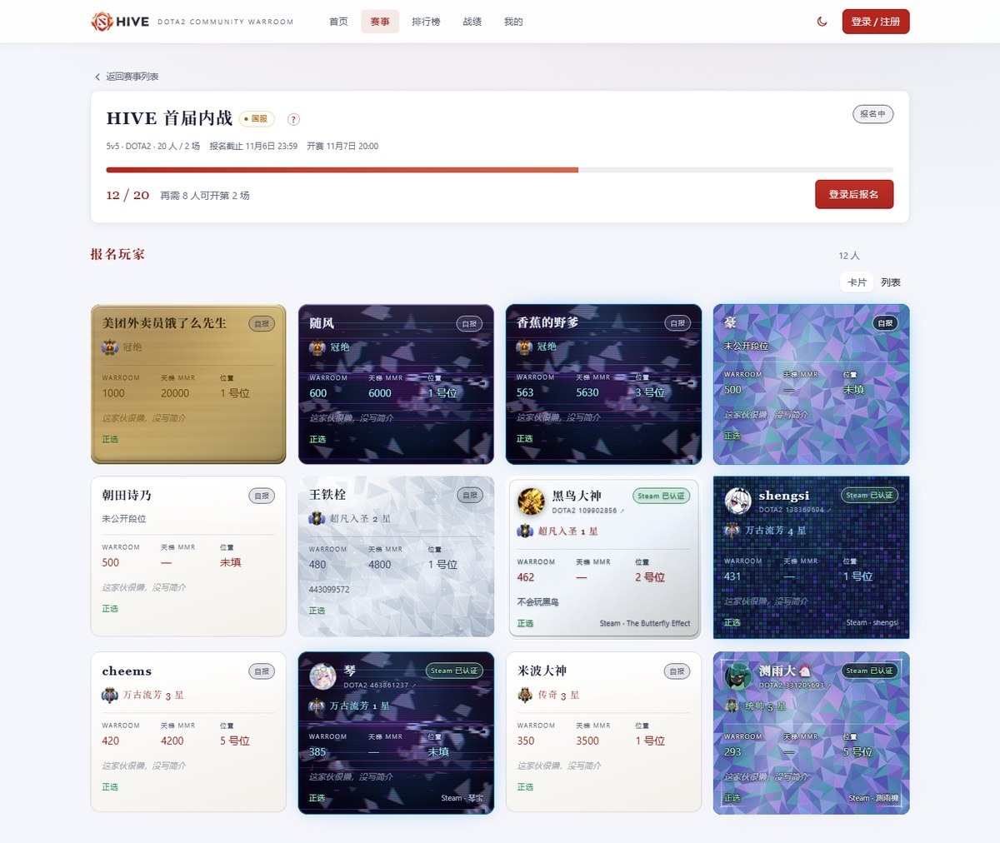
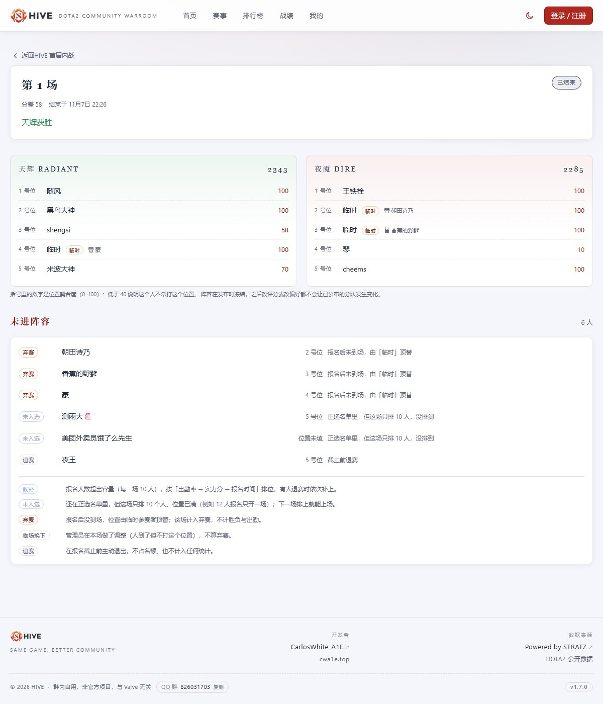
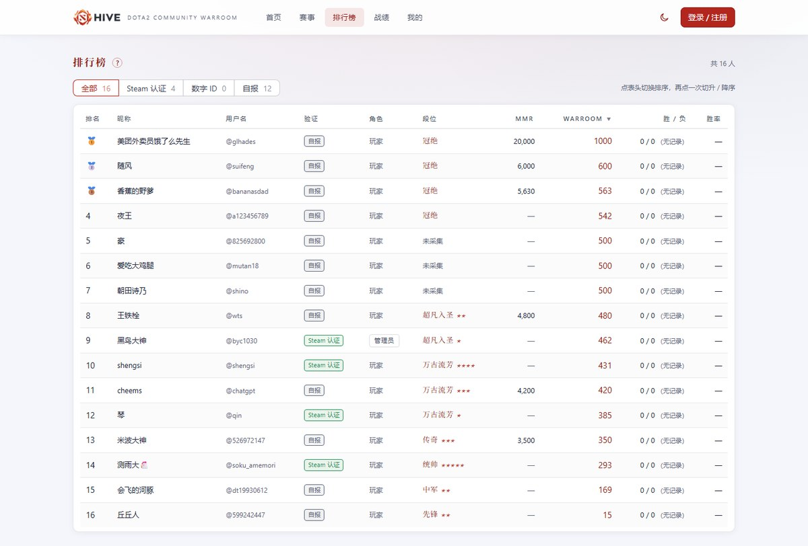
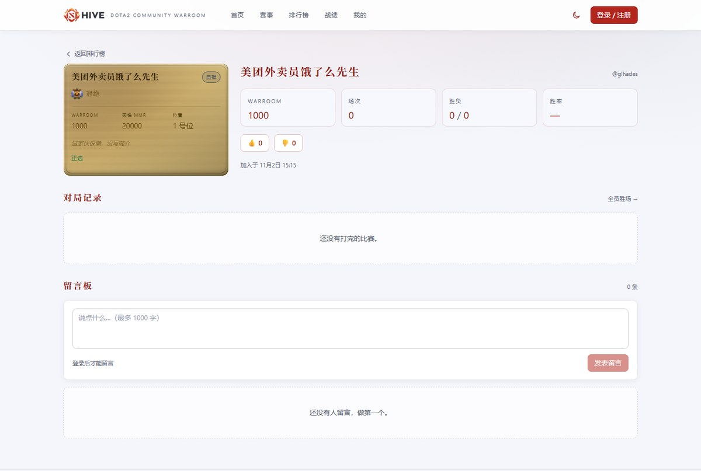
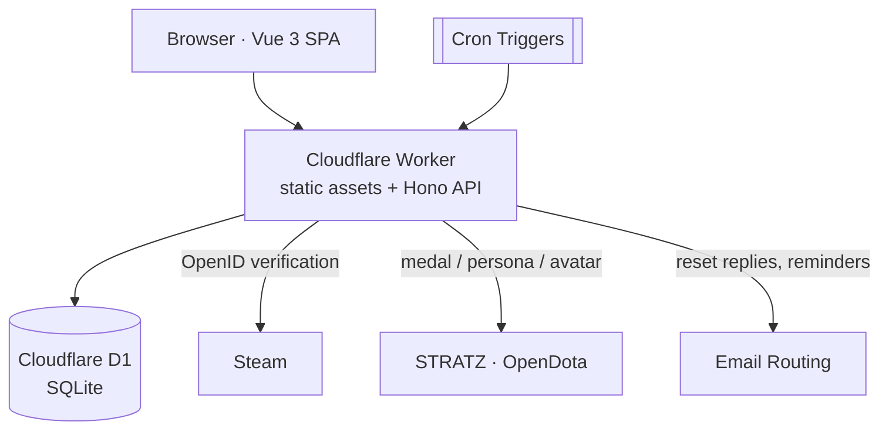

# HIVE

**A DOTA2 community in-house match platform.**

Turns "get ten people together for a game" from a chat-thread sign-up into a traceable flow: register → auto-finalize → auto-balance → publish lineups → enter results → ratings → leaderboards.

[简体中文](README.zh-CN.md) · English




## Table of contents

- [Overview](#overview)
- [Features](#features)
- [Screenshots](#screenshots)
- [Ratings & team balancing](#ratings--team-balancing)
- [Architecture](#architecture)
- [Getting started](#getting-started)
- [Scripts](#scripts)
- [Quality gates](#quality-gates)
- [Project structure](#project-structure)
- [Non-goals](#non-goals)
- [Data sources & credits](#data-sources--credits)
- [Contributing](#contributing)
- [Documentation](#documentation)
- [License](#license)

## Overview

In-house matches in a fixed community have stable properties: a fixed roster size, one game mode (DOTA2 5v5), and one organizer. The real effort is not the match itself, but the four things around it:

1. **Sign-ups** — chat-thread lists lose people, times change, players drop out late;
2. **Team selection** — hand-picked teams are lopsided, and the argument continues after the game;
3. **Skill assessment** — "who is better" is a matter of impression, and newcomers suffer;
4. **Records** — results live in chat history and never become data.

HIVE collapses all of it into one system: **registration → time-based auto-finalize → balancing → lineup publish → (late substitutions) → result entry → rating update → leaderboard & match history**. Every rating, balancing and snapshot rule is explainable, and every admin action is audited.

The system is built for a **single fixed community**, not as a multi-tenant tournament platform. That trade-off shows up in the data model, the permission model and the UI density.

> Documentation in [`docs/`](docs) is written in Chinese; this README is the English entry point.

## Features

| Area | Capability |
| --- | --- |
| **Events** | Create events, open/close registration, lock the roster, publish lineups, record results, void a match; selectable server region (CN / global). Registration closes **automatically at the deadline → roster lock → balancing → publish** (a per-minute cron), recorded as a `SYSTEM` audit entry |
| **Registration & waitlist** | Confirmed / waitlisted states; when full, the waitlist is ordered by **attendance → rating → sign-up time**; withdrawals return the slot and re-order the queue |
| **Auto-balancing** | Enumerates every feasible assignment under position constraints and picks the lowest rating gap; both team totals and position fit are shown |
| **Manual adjustments** | Drag-and-drop editor for admins; the whole lineup is submitted with an optimistic-lock version, so concurrent edits cannot silently overwrite each other |
| **Post-publish changes** | Lineups can still change after publishing: pick a substitute from the event's unused registrants, or bring in a non-registered player (name + optional MMR). Changes are logged; the replaced player is recorded as **no-show (forfeit)** or **manual swap** |
| **Lineup page** | Besides the two teams, it lists **everyone who did not make the lineup** — waitlisted (with position), not selected (confirmed but only 10 slots), forfeited, manually swapped out, withdrawn — each with a plain-language reason |
| **WARROOM rating** | Skill score derived from MMR; attendance tracked separately. Score composition, adjustment history and reasons are visible; admins can set an MMR target or a medal + stars, and the source is labelled |
| **Identity** | Steam OpenID (ownership verified) > numeric DOTA ID claim (data checked, ownership unverified) > self-reported, exposed as three honest badges |
| **Accounts & security** | Invite-code registration, sessions, failed-login lockout, CSRF and same-origin checks, audit log; **self-service password reset by email** (one-time link via a reply email) plus admin reset |
| **Player profiles** | Player card (8 materials, frame colours and effects, including the founder-only *Infinity Mirror*), match history, win/loss stats, position preferences, public profile, reactions and a comment board |
| **Leaderboards & history** | Rank by rating or wins; filter by verification level, sort by medal / MMR; community-wide win counts and per-player match history; forfeits are counted and listed |
| **Notifications** | Start-time reminder email, triggered manually by an admin (test mode sends only to the admin). On the free plan only verified destination addresses are allowed |
| **Admin console** | Events, invite codes, ratings, members, job queue and audit log; all actions are traceable, filterable and read-only |

## Screenshots

**Event detail and roster** — the same data renders as cards or a list; medals use the official DOTA2 assets:



**Lineup page** — two teams of five with position fit, followed by everyone who did not make the lineup and why:



**Leaderboard** — medal, ladder MMR and WARROOM rating side by side; click a column header to sort:



**Player profile** — public profile, match history and comment board:



## Ratings & team balancing

The rating system has a single goal: **make the outcome explainable, and verifiable when someone disputes it.**

- **Skill score** — `clamp(round(estimated MMR / 10), 0, 1000)`. MMR comes from the ranked medal or is self-reported; with no data at all the player gets a neutral 500, not 0.
- **Attendance is independent** — attendance never feeds the skill score; it only orders the waitlist. Missing a game does not make someone "weaker", but it moves them down the queue next time.
- **Attendance denominator** — only sessions where the player was actually placed in a lineup count. With 12 registrations and one 10-slot match, the two left out are *waitlisted*, not *absent*.
- **Synced data wins** — once a medal arrives via Steam or a claimed ID, the self-reported medal is invalidated; self-reporting requires unlinking first.
- **Snapshots are frozen** — registration and balancing each store a snapshot. Editing ratings afterwards never rewrites history, and a published lineup never changes quietly.
- **Forfeits have one source of truth** — only "player did not show up" (set when substituting) counts as a forfeit; a tactical swap does not. Counts are derived from the substitution log rather than stored separately, so they cannot drift from the actual attendance.
- **Balancing** — enumerate feasible assignments under position constraints and minimise the rating gap. When player count falls between two brackets the system does not guess: an admin must choose partial start, extend or cancel (the automatic path always plays with the current headcount).

## Architecture

One runtime, one database, no external middleware:



| Layer | Choice |
| --- | --- |
| Frontend | Vue 3, TypeScript, Vite, vue-router, Naive UI; light and dark themes |
| API | Hono on the edge runtime, REST + Zod validation, unified error codes and request IDs |
| Data | Cloudflare D1 (SQLite); Drizzle ORM describes the schema, SQL migrations remain the source of truth |
| Async | D1 outbox table + cron triggers (daily maintenance, per-minute job drain and deadline finalisation); no message queue |
| Email | Inbound reply (reset links) and outbound notifications (`send_email` binding) |
| Deployment | A single Worker serves both the SPA and the API; static assets via Workers Static Assets |

The baseline is the **Workers free plan** (10 ms CPU per request, at most 3 crons, no Queues, outbound email only to verified destinations). That constraint shaped several decisions: PBKDF2 iterations calibrated against measured CPU, an outbox table instead of a queue, maintenance folded into an existing cron, and email used only for replies rather than broadcasts.

## Getting started

### Prerequisites

- Node.js **20+**
- pnpm **9.15**
- A Cloudflare account (only needed for deployment)
- Optional: a [STRATZ](https://stratz.com) API token for medal syncing, a Steam Web API key for persona/avatar, and a Cloudflare Email Routing setup for password resets and reminders

### Install and run

```bash
pnpm install
pnpm build      # wrangler needs dist/ before it will start
pnpm dev        # migrate → build → serve on http://127.0.0.1:8787
```

Local development uses a local D1 database. Copy `packages/api/.dev.vars.example` to `packages/api/.dev.vars` and fill in the local secrets (see [docs/DEVELOPMENT.md](docs/DEVELOPMENT.md)). The same file name is used for remote secrets, which are uploaded with `wrangler secret put` and never committed.

> `pnpm dev:remote` runs the Worker at the edge against the **production database** — use it only to reproduce production issues.

## Scripts

| Command | Purpose |
| --- | --- |
| `pnpm dev` / `pnpm dev:api` | Local development (the latter skips the frontend rebuild) |
| `pnpm dev:remote` | Worker at the edge against the production D1 |
| `pnpm dev:web` | Vite dev server only (port 5173, `/api` proxied to 8787) |
| `pnpm build` | Build the frontend bundle |
| `pnpm typecheck` | TypeScript checks |
| `pnpm test` | Unit tests |
| `pnpm web:check` | Vue template check (syntax errors, undefined bindings) |
| `pnpm db:check` | Column-level parity between migrations and the Drizzle schema |
| `pnpm db:migrate:local` / `db:migrate:remote` | Apply migrations |
| `pnpm db:backup` | Export the production database to `backups/` |
| `pnpm sec:check` | Security attack cases (requires `pnpm dev` to be running) |
| `pnpm run deploy` | Deploy to Cloudflare (note the `run`) |

## Quality gates

| Item | Current state |
| --- | --- |
| Unit tests | 20 files, 199 cases — rating formula, balancing, frozen snapshots, waitlist ordering, forfeit and lineup-gap attribution, Steam callback verification, mailer wiring |
| Security cases | 74 — authorization matrix, CSRF, injection, privilege escalation, privacy leaks, XSS, malformed input |
| Schema parity | Migrations compared column by column with the Drizzle schema (24 tables / 288 columns / 55 indexes) |
| Template check | 41 `.vue` files compile |
| Required before merge | `typecheck`, `test`, `build`, `db:check`, `web:check`; add `sec:check` for auth or API changes |

Security design and residual risk: [docs/SECURITY-AUDIT.md](docs/SECURITY-AUDIT.md).

## Project structure

```text
apps/web/                 Vue SPA (pages, components, styles, assets)
packages/api/             Worker entry, routes, services, background jobs
packages/database/        Migration SQL, Drizzle schema, parity scripts
packages/shared/          Shared types, constants and error codes
scripts/                  Security self-check, Vue template check
docs/                     Architecture, database, API, UI, development, security docs
```

## Non-goals

Deliberately out of scope, to keep the system small:

- Captain drafting or hand-picked teams (balancing is algorithmic; admins only nudge)
- Multi-community / multi-tenant, multiple game modes (DOTA2 5v5 only)
- KDA and per-match detail stats (the winner is entered by an admin); no OpenDota match import
- Lobby creation, voice chat, a chat client, other games
- Redis, message queues, microservices or any extra infrastructure
- Public sign-up (registration requires an invite code handed out in the group)

## Data sources & credits

Medals, ladder MMR, personas and avatars come from the public [STRATZ](https://stratz.com) API, with [OpenDota](https://www.opendota.com) as a fallback when a medal is missing. Ownership verification uses Steam OpenID. Rank icons use the official DOTA2 medal and star assets.

Community entry: QQ group `826031703` (the footer copies the number with one click).

DOTA2 and Steam are trademarks of Valve Corporation. This is an unofficial project for a private community and is not affiliated with Valve.

## Contributing

The community is invite-only and the repository is maintained by its organiser. Bug reports and suggestions are welcome through issues; please do not commit secrets, production dumps or personal data.

## Documentation

| Document | Contents |
| --- | --- |
| [docs/ARCHITECTURE.md](docs/ARCHITECTURE.md) | Architecture decisions, auth flows, rating and balancing algorithms, jobs, release flow |
| [docs/DATABASE.md](docs/DATABASE.md) | Tables, invariants, D1 constraints, migration conventions |
| [docs/API.md](docs/API.md) | REST contracts, error codes, concurrency and snapshot semantics |
| [docs/UI.md](docs/UI.md) | Pages and routes, component inventory, state mapping, design rules |
| [docs/DEVELOPMENT.md](docs/DEVELOPMENT.md) | Local environment, script contracts, coding conventions |
| [docs/SECURITY-AUDIT.md](docs/SECURITY-AUDIT.md) | Security controls, attack-case results, residual risk |
| [docs/SMOKE-TEST.md](docs/SMOKE-TEST.md) | Pre-release smoke tests: migration behaviour and CPU budget |

All documents above are written in Chinese.

## License

Private community project. No open-source license is granted; all rights reserved. Contact the maintainer before reusing designs or code.
