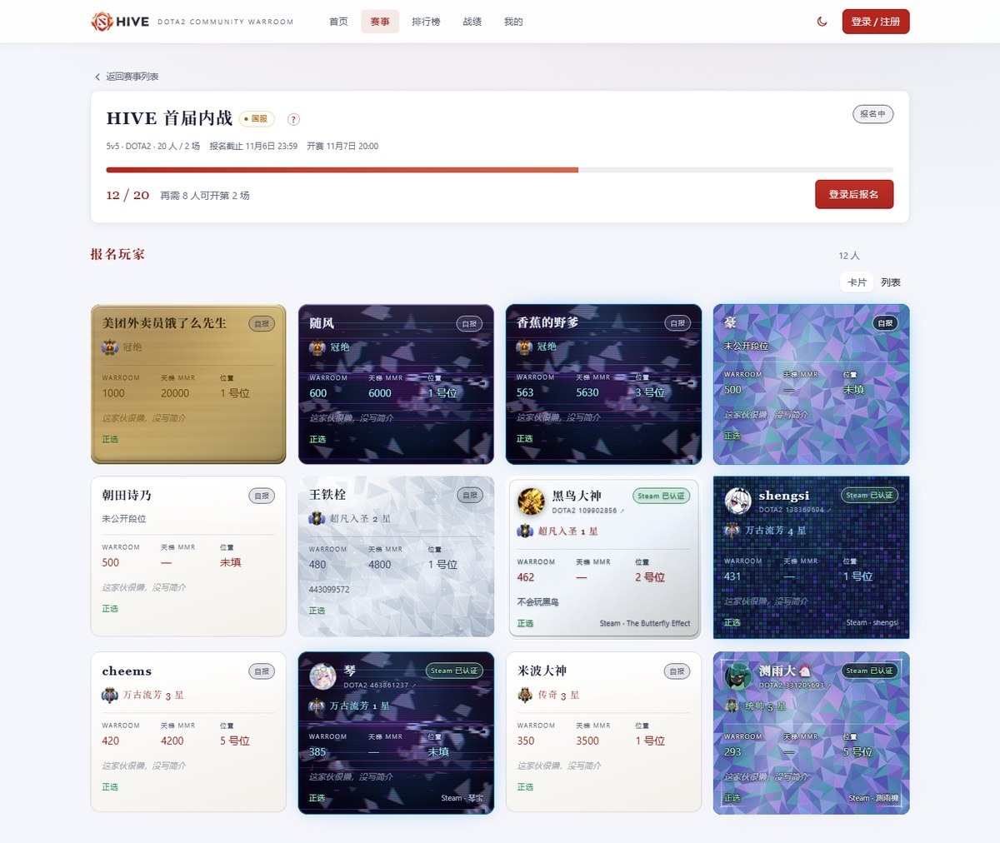
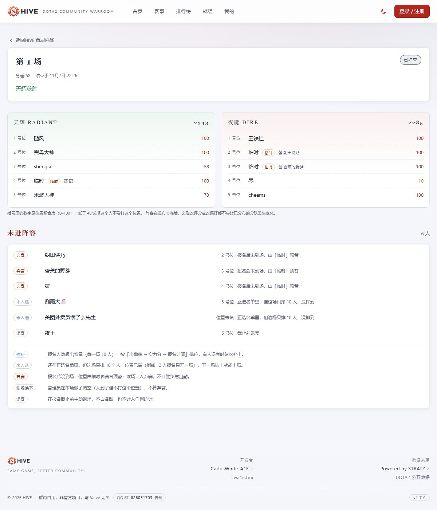
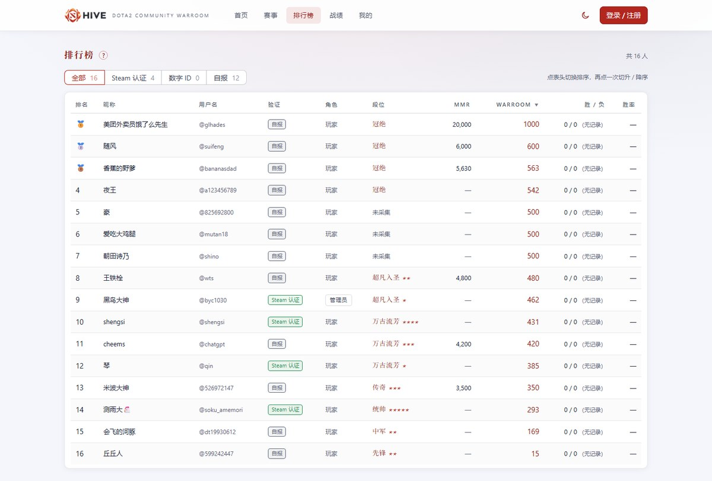
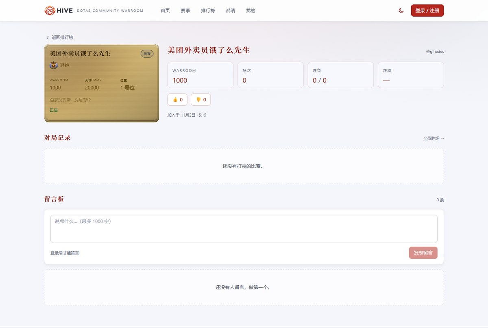
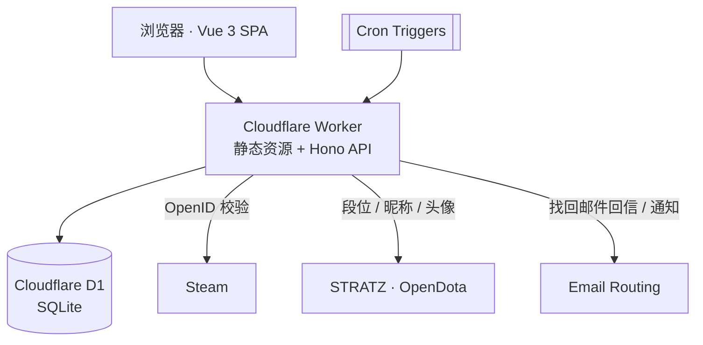

# HIVE

**DOTA2 社区内战（WARROOM）平台。**

把「凑十个人打一场内战」从群聊里的接龙，变成一条可报名、可分队、可追溯的流程：报名 → 自动截止 → 自动分队 → 发布阵容 → 结果录入 → 评分更新 → 排行榜与战绩。

[English](README.md) · 简体中文


## 目录

- [项目简介](#项目简介)
- [核心特性](#核心特性)
- [界面预览](#界面预览)
- [评分与分队](#评分与分队)
- [技术架构](#技术架构)
- [本地运行](#本地运行)
- [脚本](#脚本)
- [质量保障](#质量保障)
- [仓库结构](#仓库结构)
- [项目边界](#项目边界)
- [数据来源与致谢](#数据来源与致谢)
- [参与贡献](#参与贡献)
- [相关文档](#相关文档)
- [许可](#许可)

## 项目简介

固定社区的内战有几个稳定的特征：人数固定、赛制固定（DOTA2 5v5）、组织者固定。真正消耗精力的不是比赛本身，而是比赛之前的四件事：

1. **报名**——群接龙容易漏人、改时间、临时退赛；
2. **分队**——凭手感分人，强弱失衡，打完还要争论；
3. **实力评估**——谁强谁弱全凭印象，新人尤其吃亏；
4. **记录**——比赛结果散落在聊天记录里，无法沉淀成数据。

HIVE 将上述环节收敛到单一系统中：**报名 → 到点自动截止 → 分队 → 阵容发布 →（临时换人）→ 结果录入 → 评分更新 → 排行榜与战绩**。所有评分、分队与快照规则均公开可解释，管理员的操作全程留有审计记录。

系统面向**单一固定社区**设计，而非多租户的通用赛事平台；这一取舍体现在数据模型、权限模型与界面密度上。

## 核心特性

| 模块 | 能力 |
| --- | --- |
| **赛事组织** | 创建赛事、开放/关闭报名、封盘、发布阵容、录入结果、流局；服务器区域（国服 / 全球服）可选；**报名到点自动截止 → 封盘 → 分队 → 发布**（每分钟 Cron 巡检，全程记 `SYSTEM` 审计） |
| **报名与候补** | 正选 / 候补两态；满员后按「出勤率 → 实力分 → 报名时间」排序候补；退赛自动回归并重排 |
| **自动分队** | 按位置约束与实力均衡枚举可行组合，取分差最小者；结果附双方总分与位置契合度 |
| **人工微调** | 管理员可视化拖拽换人，整份提交并带乐观锁版本号，避免多人同时编辑互相覆盖 |
| **赛后换人** | 已发布阵容仍可调整：从本赛事未上场者里选替补，或让没报名的人临时参赛（只记名字与可选天梯分）；换人写流水，被换下的正选按原因记为**弃赛**或**临场调整** |
| **阵容页信息** | 除两队名单，还列出**没进这套阵容的人**：候补（带顺位）、未入选（正选但这一场只排 10 人）、弃赛、临场换下、退赛，并逐条解释原因 |
| **WARROOM 评分** | 由天梯 MMR 推导的实力分，出勤独立统计；评分构成、历史修正与原因均可查看；管理员可设定天梯分或「段位 + 星级」，并标注数据来源 |
| **身份体系** | Steam OpenID（归属已验证）> 数字 ID 声明（数据已校验、归属未验证）> 手动填写（自报），三级徽章如实标注可信度 |
| **账号与安全** | 邀请码注册、会话管理、登录失败锁定、CSRF 与同源校验、审计日志；**邮件自助找回密码**（回信一次性链接）与管理员重置双通道 |
| **玩家档案** | 玩家卡（8 种材质、边框配色与光效，含创始人专属「无限镜」）、对局记录、胜负统计、位置偏好、公开主页、点赞与留言板 |
| **排行榜与战绩** | 按评分或胜场排名，可筛选验证等级并按段位 / MMR 排序；全员胜场与个人对局记录；弃赛次数与明细可见 |
| **通知** | 开赛提醒邮件：管理员在赛事页手动触发，可先只发自己验通道；免费版仅放行已验证目的地地址 |
| **管理后台** | 赛事、邀请码、评分、成员、任务队列与审计日志；操作留痕、可筛选、只读可追溯 |

## 界面预览

**赛事详情与报名名单**——同一份数据支持卡片与列表两种视图，段位使用官方勋章图标：



**阵容页**——两队十人的位置与契合度，下方是未进阵容的名单与原因（候补 / 未入选 / 弃赛 / 临场换下 / 退赛）：



**排行榜**——段位、天梯 MMR 与 WARROOM 分列展示，点击表头可切换排序：



**玩家主页**——公开档案、对局记录与留言板：



## 评分与分队

评分体系的设计目标只有一条：**让分队结果可以被解释，也可以被质疑后验证**。

- **实力分**：`clamp(round(估计 MMR / 10), 0, 1000)`。MMR 由段位换算或玩家自行填写；没有任何数据时给予 500 的中性值，而不是 0 分。
- **出勤独立**：出勤率不进入实力分，只参与候补排序。缺席一场不会让一个人「变弱」，但会让他下次报名时排得更靠后。
- **出勤口径**：分母只算「被排进过阵容」的场次，而不是「报名过」——12 人报名只开一场时，没排上的 2 人是候补，不是缺勤。
- **段位优先**：一旦通过 Steam 或数字 ID 同步到段位，手工填写的段位即失效；要恢复手填需先解除绑定。
- **快照冻结**：报名与分队各保存一份快照，赛后修改评分不会回写历史快照，已发布的阵容不会悄然改变。
- **弃赛只认一种事实**：换人时勾选「本人没来」才记为弃赛（`ABSENT`），临场调整（`MANUAL`）不算；统计从换人流水现算，不另存计数，避免与实际出勤漂移。
- **分队**：在位置约束下枚举可行组合，最小化两队总分差；人数卡在两档之间时不做隐式决策，必须由管理员显式选择部分开局、延期或取消（到点自动结算时固定按「现有人数开局」处理）。

## 技术架构

单一运行时、单一数据库、无外部中间件：



| 层 | 选型 |
| --- | --- |
| 前端 | Vue 3、TypeScript、Vite、vue-router、Naive UI，深浅色双主题 |
| 接口 | Hono（边缘运行时），REST + Zod 校验，统一错误码与请求 ID |
| 数据 | Cloudflare D1（SQLite），Drizzle ORM 描述结构，SQL 迁移为唯一真源 |
| 异步 | D1 outbox 表 + Cron 触发器（每日维护、每分钟任务派发与到点结算），无消息队列 |
| 邮件 | 收信回复（重置链接）与主动发信（开赛提醒，`send_email` 绑定） |
| 部署 | 单个 Worker 同时提供页面与接口，静态资源由 Workers Static Assets 承载 |

运行基线为 **Workers 免费版**（单请求 CPU 10ms、Cron 至多 3 条、无 Queues、主动发信仅限已验证目的地）。这一约束直接影响了几个设计决策：密码哈希迭代次数按实测 CPU 校准、异步任务改用数据库表实现 outbox、每日维护合并进已有的 Cron 表达式、邮件只做「回信」而非群发。

## 本地运行

### 环境要求

- Node.js **20 及以上**
- pnpm **9.15**
- Cloudflare 账号（仅在部署时需要）
- 可选：用于同步段位的 [STRATZ](https://stratz.com) API token、用于昵称头像的 Steam Web API key、用于密码找回与提醒的 Cloudflare Email Routing

### 安装与启动

```bash
pnpm install
pnpm build      # wrangler 需要 dist/ 才肯启动
pnpm dev        # 迁移 → 构建 → 起服务（http://127.0.0.1:8787）
```

本地开发使用本地 D1 数据库。把 `packages/api/.dev.vars.example` 复制为 `packages/api/.dev.vars` 并填好本地密钥（见 [docs/DEVELOPMENT.md](docs/DEVELOPMENT.md)）。生产密钥走 `wrangler secret put`，从不入库。

> `pnpm dev:remote` 会让 Worker 在边缘运行、直连**生产库**——只用于复现线上问题。

## 脚本

| 命令 | 用途 |
| --- | --- |
| `pnpm dev` / `pnpm dev:api` | 本地开发（后者跳过前端重建，只起 Worker） |
| `pnpm dev:remote` | Worker 跑在边缘、直连生产库 |
| `pnpm dev:web` | 仅 Vite 热更新（5173，`/api` 已代理到 8787） |
| `pnpm build` | 构建前端产物 |
| `pnpm typecheck` | 类型检查 |
| `pnpm test` | 单元测试 |
| `pnpm web:check` | Vue 模板体检（语法错与未定义绑定） |
| `pnpm db:check` | 迁移与 Drizzle Schema 的逐列一致性校验 |
| `pnpm db:migrate:local` / `db:migrate:remote` | 应用迁移 |
| `pnpm db:backup` | 导出生产库到 `backups/` |
| `pnpm sec:check` | 安全攻击用例（需先启动 `pnpm dev`） |
| `pnpm run deploy` | 部署到 Cloudflare（必须带 `run`） |

## 质量保障

| 项目 | 现状 |
| --- | --- |
| 单元测试 | 20 个测试文件、199 个用例，覆盖评分公式、分队算法、快照冻结、候补排序、弃赛与未进阵容归因、Steam 回调校验、发信结构 |
| 安全用例 | 74 项，覆盖授权矩阵、CSRF、注入、越权、隐私泄露、XSS 与异常输入 |
| 结构校验 | SQL 迁移与 Drizzle Schema 逐列比对（24 表 / 288 列 / 55 索引） |
| 模板体检 | 41 个 `.vue` 文件编译通过 |
| 交付门禁 | `typecheck`、`test`、`build`、`db:check`、`web:check`；涉及鉴权与接口变更时追加 `sec:check` |

安全设计与残余风险评估见 [docs/SECURITY-AUDIT.md](docs/SECURITY-AUDIT.md)。

## 仓库结构

```text
apps/web/                 前端 SPA（页面、组件、样式、资产）
packages/api/             Worker 入口、路由、服务层与异步任务
packages/database/        迁移 SQL、Drizzle Schema、结构一致性校验脚本
packages/shared/          前后端共享的类型、常量与错误码
scripts/                  安全自检、Vue 模板体检等仓库级脚本
docs/                     架构、数据库、接口、界面、开发与安全文档（含配图）
```

## 项目边界

明确**不做**以下内容，以保持系统简单可控：

- 队长选人与手动组队（分队由算法完成，人工只做微调）
- 多社区 / 多租户、多赛制（仅 DOTA2 5v5）
- KDA 与详细对局数据统计（胜负由管理员在赛后指定）；不做 OpenDota 对局导入
- 自动建房、实时语音、聊天室、跨游戏扩展
- 引入 Redis、消息队列、微服务等额外基础设施
- 面向陌生人的公开注册（注册必须携带群内发放的邀请码）

## 数据来源与致谢

段位、天梯分、游戏昵称与头像来自 [STRATZ](https://stratz.com) 的公开数据接口，段位缺失时回退 [OpenDota](https://www.opendota.com)。归属验证使用 Steam OpenID。玩家卡片中的段位图标使用 DOTA2 官方勋章与星级素材。

社区入口：QQ 群 `826031703`（页脚可直接复制群号）。

DOTA2 与 Steam 是 Valve Corporation 的商标。本项目为社区自用的非官方项目，与 Valve 无关。

## 参与贡献

社区为邀请制，仓库由组织者维护。问题与建议欢迎通过 issue 提出；请勿提交密钥、生产数据导出或他人隐私信息。

## 相关文档

| 文档 | 内容 |
| --- | --- |
| [docs/ARCHITECTURE.md](docs/ARCHITECTURE.md) | 架构决策、认证流程、评分与分队算法、异步任务、发布流程 |
| [docs/DATABASE.md](docs/DATABASE.md) | 表结构说明、核心不变量、D1 约束与迁移规范 |
| [docs/API.md](docs/API.md) | REST 接口契约、错误码、并发与快照语义 |
| [docs/UI.md](docs/UI.md) | 页面与路由、组件清单、状态映射与设计约定 |
| [docs/DEVELOPMENT.md](docs/DEVELOPMENT.md) | 本地环境、脚本契约、编码规范 |
| [docs/SECURITY-AUDIT.md](docs/SECURITY-AUDIT.md) | 安全控制清单、攻击用例结果与残余风险 |
| [docs/SMOKE-TEST.md](docs/SMOKE-TEST.md) | 上线前冒烟测试：迁移行为与 CPU 配额校准 |

## 许可

本仓库为社区内部项目，未附带开源许可，保留所有权利。如需复用其中的设计或代码，请先与维护者联系。
