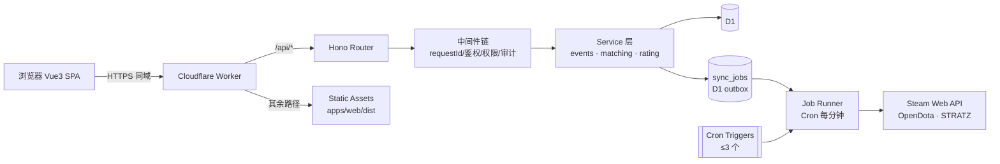
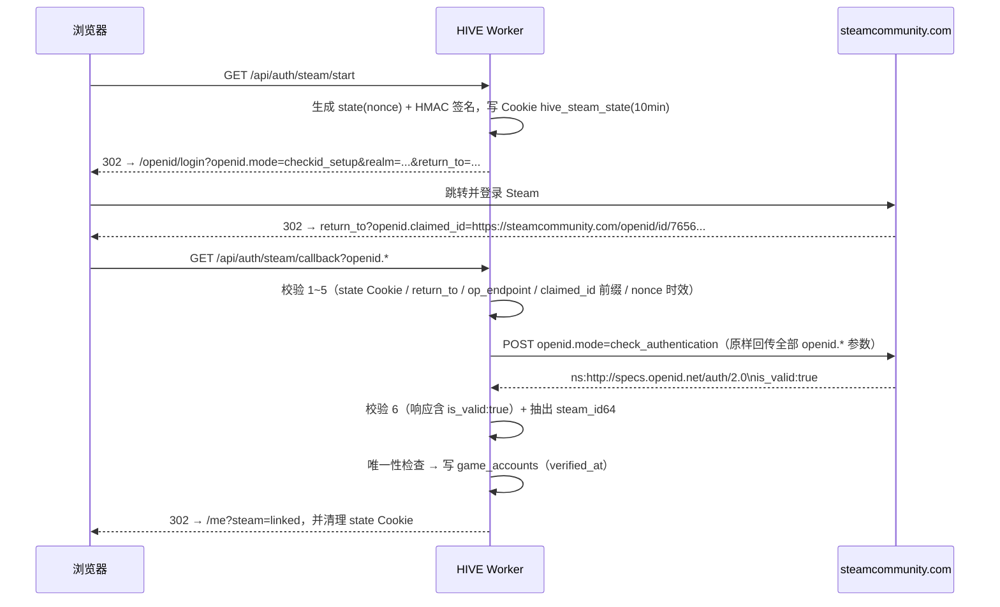

# HIVE · ARCHITECTURE

> 状态：V1.0 设计基线。范围锁定为单社区、DOTA2 5v5；**实际 15 人量级、每月 4～10 场**，容量规划留到 100 人。
> 本文回答"为什么这样分层、请求怎么走、钱和时间花在哪"，实现细节见 [API.md](API.md)、[DATABASE.md](DATABASE.md)、[DEVELOPMENT.md](DEVELOPMENT.md)。

## 1. 架构决策记录

| 决策 | 结论 | 理由 / 代价 |
| --- | --- | --- |
| 服务端框架 | NestJS → **Hono** | Workers 无常驻进程、无反射元数据；Hono 的路由 + 中间件模型与 Fetch API 同构，冷启动近乎为零。代价：失去 Nest 的 DI/模块体系，需自建轻量分层 |
| 数据库 | PostgreSQL+Prisma → **D1+Drizzle** | D1 由平台托管、随 Worker 部署；Drizzle 是纯 TypeScript、无引擎二进制，适合 Workers。代价：SQLite 方言，无 `JSONB`/原生 `UUID` |
| 缓存 | Redis → **无** | 这个规模下缓存没有收益，只会引入一致性 bug |
| 异步任务 | Queues → **D1 outbox + Cron** | Queues 属 Workers 付费计划，免费版用不了。改为 `sync_jobs` 表 + 每分钟 Cron 抽干，保留退避重试/死信语义；消息契约与 Queues 一致，升级后只需换投递实现 |
| 部署单元 | 前后端分离 → **单一 Worker** | 同域名、无 CORS、Cookie 无跨站问题；静态资源由 Workers Static Assets 直接返回，不消耗 Worker 调用 |
| 实时能力 | 暂不需要 | 阵容发布是一次性动作，轮询（15s）足够；Durable Objects 只在需要 WebSocket 时再引入 |
| 认证 | 自建会话 → **不透明 token + D1 会话表** | 可撤销、可踢人；比 JWT 多一次读，但换来"退出即失效"的正确性 |

### 1.1 规模校准（每月 4～10 场、10～20 人）

按 8 场/月、15 人算：一年约 96 场、1,700 条报名、960 条 `team_members`，全库 5 年不超过 30 MB；日均请求不到 400，加上每分钟的 drain Cron 约 1,800 次/天，仍不到免费额度的 2%。**在这个量级上基础设施不是瓶颈，任何"性能优化"都是自嗨。**

真正稀缺的是两样东西：

1. **管理员的耐心。** 每场比赛要走"建赛事 → 开报名 → 生成分组 → 发布 → 录结果"五步，8 场/月就是 40 次操作，且集中在开赛前两小时。所以 `events` 必须支持"复制上一期"、分组必须能"沿用上次阵容作为初值"——这两项比任何算法优化都值钱。
2. **凑够 10 个人。** 15 人报名只能开 1 场，5 个人轮空。**候补不是边界情况，是每周的常态**，它比分组算法更决定社区体验（见 §7 最后一条）。

由此产生的取舍：不做缓存、不做预计算、不做读写分离；`sync_jobs` 保留但走低频（见 §8）；唯一值得认真对待的技术指标是"登录路径的 CPU"和"分组算法的结果是否让人服气"。

## 2. 运行拓扑



一个 Worker、一个域名、一个数据库。`/api/*` 走 Worker 逻辑，其余交给静态资源层，SPA 的深链接由 `not_found_handling: single-page-application` 回落 `index.html`。

## 3. 代码结构与依赖方向

```
hive/
├── apps/web/                 # Vue 3 + Vite，只负责渲染与交互
├── packages/api/             # Hono Worker 入口（wrangler.jsonc 在此）
├── packages/database/        # SQL 迁移（真源）+ Drizzle Schema
├── packages/shared/          # 类型、Zod 校验器、常量、错误码
└── docs/                     # 本次交付的工程基线
```

依赖只允许单向流动：

```
apps/web ──► packages/shared
packages/api ──► packages/shared
packages/api ──► packages/database
packages/database ──► (无业务依赖)
```

三条硬规则：

1. **分组算法与评分算法只在 `packages/api/src/algorithms/` 里。** 前端不得计算队伍总分，只展示接口返回值——否则"页面上的总分"和"数据库里的快照"一定会分叉。
2. **`packages/shared` 不依赖任何运行时。** 它只放类型、Zod schema、常量与错误码，前后端共用同一份报名/评分契约。
3. **数据库访问只出现在 `repositories/` 与 `services/`。** 路由处理器不直接写 SQL。

## 4. 请求生命周期

```
请求 → requestId → 结构化日志 → secureHeaders(CSP 等) → Origin 校验
     → 会话解析（读 Cookie）→ 路由级权限守卫 → Zod 入参校验
     → Service → Repository（Drizzle/D1）
     → 统一响应包装 → 日志落盘（含耗时、DB 语句数）
```

- `requestId` 用 `crypto.randomUUID()`，回写响应头 `x-request-id`，并写入 `audit_logs.request_id`，客服排查时一个 ID 串起"用户操作 → 审计记录 → 日志"。
- 错误一律 `{ error: { code, message, details? }, requestId }`，不向客户端抛栈。
- 写操作统一 `db.batch()`；D1 没有交互式事务，这一点决定了 service 的写法必须是"算好全部语句再一次提交"。

## 5. 认证设计

### 5.1 平台账号

- 注册：**邀请制**。`REGISTRATION_REQUIRE_INVITE=true` 时 `inviteCode` 为必填，校验「存在 / 未撤销 / 未过期 / 未用尽」四项后原子消耗一次；失败统一返回 `INVITE_INVALID`，不区分具体原因（避免枚举有效码）。注册成功后 `users.invite_code_id` 记录来源，便于"谁邀请进来的"溯源与拉新统计。
- 消耗邀请码与建号必须成对：先 `UPDATE invite_codes SET used_count = used_count + 1 WHERE ... AND (max_uses = 0 OR used_count < max_uses) RETURNING used_count`，无返回行即拒绝；随后 `db.batch([insert users, insert player_ratings, insert player_positions])`。若 batch 因唯一冲突失败，补偿一次 `used_count - 1`。
- 密码：`username`（小写、3-24、`[a-z0-9_]`）+ `password`。用 **PBKDF2-HMAC-SHA256**（WebCrypto 原生，无额外依赖），并对密码先做一层 `HMAC-SHA256(PASSWORD_PEPPER, password)` 再入 PBKDF2——pepper 只存在于 secret，**不落库**，因此拿到 D1 备份也无法离线爆破。存储格式 `pbkdf2_sha256$p1$<iterations>$<salt_b64>$<hash_b64>`，四个字段都可随记录升级。
- 免费版每请求 CPU 上限 10ms。**2026-10-30 在真实免费版实测**：单次 PBKDF2 的 10ms 边界大约等于 **100,000 次迭代**（100k 通过 3/3，105k 全部撞 1102），折合约 95ns/次。据此取 **50,000 次（≈4.8ms）**，把剩下的 5ms 留给路由、校验与响应序列化。这仍低于 OWASP 对 PBKDF2-SHA256 的建议值，补偿靠 pepper + 账号锁定 + 边缘限流，而不是假装它很安全。升级付费版后调到 310,000，并在下次登录时静默重算 hash。
- 防爆破：账号级锁定（连续失败 5 次锁 15 分钟，字段在 `users` 表），不做 IP 维度自建限流；需要时直接上 Cloudflare Rate Limiting Rules，零代码。
- 会话：登录生成 32 字节随机 token（base64url），只把 `sha256(token)` 存 `sessions.id`。Cookie `hive_session`：`HttpOnly; Secure; SameSite=Lax; Path=/`。空闲 72 小时或总时长 14 天过期；`last_seen_at` 每小时最多更新一次，避免写放大。
- CSRF：`SameSite=Lax` 挡掉跨站表单；所有非 GET 请求额外要求自定义头 `X-HIVE-CSRF: 1` 并校验 `Origin`/`Referer` 与 `APP_ORIGIN` 一致——自定义头无法被简单表单伪造。

### 5.2 Steam OpenID 绑定

Steam 用的是 **OpenID 2.0**（不是 OAuth）。只有一条铁律：**回调参数一律不可信，必须由服务端反向 POST 校验。**



六个校验点，缺一不可：

| # | 校验 | 不做会怎样 |
| --- | --- | --- |
| 1 | `hive_steam_state` Cookie 存在且 HMAC 有效、未过期 | 任意人构造回调 URL 就能绑定任意 Steam 账号（CSRF / 账号劫持） |
| 2 | 回调中的 `openid.return_to` 与发起时完全一致 | 攻击者把 return_to 换成自己的站点，窃取断言 |
| 3 | `openid.op_endpoint === https://steamcommunity.com/openid/login` | 伪造 OpenID Provider 自签断言 |
| 4 | `openid.claimed_id` 匹配 `^https://steamcommunity.com/openid/id/(\d{17})$` | 从任意文本里"解析"出伪造的 SteamID |
| 5 | `state` 一次性消费（成功后立即删除 Cookie） | 重放已通过的断言 |
| 6 | 反向 POST 返回体包含 `is_valid:true` | 只信浏览器回传的参数 = 完全没有校验 |

补充实现要点：

- 反向校验请求必须用 `POST` + `application/x-www-form-urlencoded`，把所有收到的 `openid.*` 参数原样回传，仅把 `openid.mode` 改为 `check_authentication`；**不要**跟随 302。
- Steam 可能追加非 OpenID 参数（如我们的 `state`），它们不在 `openid.signed` 里，因此 state 只能从 Cookie 取，不能从 query 取。
- `steam_id64` 全局唯一：若已绑定其他 HIVE 账号，返回 `STEAM_ALREADY_LINKED`，提示"该 Steam 已被绑定"，绝不静默覆盖。
- `dota_account_id = steam_id64 - 76561197960265728`（32 位账号 ID，OpenDota/STRATZ 部分接口要用）。
- `STEAM_WEB_API_KEY` 只用于取昵称与头像，**不参与身份校验**；缺 Key 时绑定仍应成功，只是 persona 为空。

### 5.3 三种身份接入与可信度分级

**先把事实说清楚**：Steam OpenID 只是跳转到 `steamcommunity.com` 确认"你是这个 SteamID"，**本站全程接触不到密码，也拿不到任何操作权限**。用户担心的"盗号"来自对它和"输入 Steam 账号密码"的混淆。但恐惧是真实的、会直接影响注册转化，所以三条路径并存：

| 路径 | 输入 | 归属可信 | 段位来源 | 前置条件 |
| --- | --- | --- | --- | --- |
| A. Steam OpenID | 点一下跳转 | ✅ 是 | 接口抓取 | 对方开启「公开比赛数据」 |
| B. 数字 account_id | 如 `109902856` | ❌ 否 | 接口抓取 | 同上 |
| C. 手动填写 | 段位 / MMR | ❌ 否 | 自报 | 无 |

徽章由 `game_accounts` + `player_stats` 派生，不落库（避免两处状态不一致）：

| 徽章 | 条件 | 文案 | 颜色 |
| --- | --- | --- | --- |
| `VERIFIED` | provider=STEAM_OPENID 且 `rank_tier` 有值 | 已认证 | 绿 |
| `VERIFIED_NO_DATA` | provider=STEAM_OPENID 但没抓到段位 | 已验证 · 段位未公开 | 蓝 |
| `CLAIMED` | provider=DOTA_ACCOUNT_ID 且有抓取数据 | 数据已校验 · 归属未验证 | 黄 |
| `SELF_REPORTED` | 无 game_accounts 或 `rank_source=SELF_REPORTED` | 自报（未验证） | 灰 |

对评分的影响——不需要新增字段，复用已有的 `confidence_bp`：

```
confidence = 基础置信度 × 可信度系数
              VERIFIED 1.0 / CLAIMED 0.8 / SELF_REPORTED 0.5
```

于是 §6 的 `admin_adjustment_limit = 150 + 350×(1−confidence)` 会自动放宽：未验证玩家的修正上限接近 ±500，管理员可以直接把他摆到正确位置，而不是被一个自报的 "Immortal" 锁死在 900 分。前端同时显示不确定度 `876 ±90`（`±round(300×(1−confidence))`），**不假装自己精确**。

防滥用：

- 冒领他人 ID：`ux_game_accounts_dota_account_id` 唯一索引保证一个 account_id 只能被一个 HIVE 账号占用；但无法阻止"第一个冒领职业选手的人"——这正是徽章存在的理由。
- 谎报段位：徽章是灰的，分组编辑器同队可见。在 15 人的社区里，社交压力比技术校验有效得多。
- **数字 ID 是公开的**：绑定 / 声明过的 `dota_account_id` 会随报名名单（`GET /api/events/:id/registrations`）一起发给所有看得到名单的人，卡片上渲染成 `DOTA2 <id> ↗` 直链 OpenDota。这是"归属未验证"的人唯一能被外部核对的凭据——旁观者可以拿它去 OpenDota / Dotabuff / STRATZ 比对该账号公开的段位与战绩。
- **只有公开数据才有效**：这些核对都依赖对方在 Dota2 里开启「公开比赛数据」。没开时 OpenDota 抓不到段位，徽章停在「自报」；声明 ID 也**不会**覆盖玩家手填的段位（`POST /api/me/game-account/claim` 在 `rank_tier` 为空时只更新场次）。所以一张卡上"ID 有值 + 徽章是自报"是正常状态，不矛盾。
- 升级路径（P2）：要求玩家在游戏内个人签名里写入一次性 token，再由 OpenDota 的 `personaname`/profile 侧证，可在不暴露 Steam 密码的前提下证明归属。

## 6. 实力评分（WARROOM Rating）

三层结构与"快照冻结"规则见 [DATABASE.md §4.1–4.2](DATABASE.md)。这里只讲算法。

```
system_rating = clamp(round(estimated_mmr / 10), 0, 1000)
# estimated_mmr = 自报 MMR（SELF_REPORTED）或勋章/星级估算；
# 两者都没有 → 500 中性值（不是 0，避免把"没填资料"当成菜）
attendance_bp = round(played / registered × 10000)    # 无报名记录 → NULL
effective_rating = clamp(system_rating + admin_adjustment, 0, 1000)

# 置信度只用于"展示的不确定度 / 管理员修正上限"，不收缩实力分
confidence = min(1, career_matches / 300)
admin_adjustment_limit = ADMIN_ADJUSTMENT_LIMIT + round(350 × (1 - confidence))   # 150 → 500

# 候补顺序（只作用于 WAITLIST，不影响正选与分队）
sort_key = (attendance_bp ?? 5000) DESC → effective_rating_snapshot DESC → created_at ASC → id ASC
```

设计取舍：

- **实力与可靠性分开**。出勤不再进入 `system_rating`：技术好但少来的人不会被扣成低分、以更低分进池；出勤只决定候补顺序。正选仍然先到先得，分队只看实力分。
- **没有出勤记录按 50% 中性值排队**：新人既不被惩罚，也不会因为"没有污点"直接插到全勤玩家前面。
- **样本量只影响不确定度**。`career_matches` 来自 OpenDota，量级远大于社区赛；它不再把高分往 500 拉。旧版 `500 + (raw−500) × max(confidence, 0.8)` 会把 9000 分压到 820，等于用"打得少"否定真实水平；现在 9000 分就是 900，置信度单独显示。
- **分数上限的来源**：`estimated_mmr` 优先用自报 MMR（仅 `SELF_REPORTED`），同步了 OpenDota 后以勋章/星级估算（`estimateMmr`），避免"手填 9000 + 同步到先锋"的错配；没有段位时 `system_rating = 500`、`confidence = 0`，由管理员在 ±500 范围内修正。
- **候补优先级的顺序固定为出勤率 → 实力分（报名快照）→ 报名时间**。没有出勤记录时用 `5000`（50%）参与排序；位置在 `services/waitlist.ts` 里统一重排，报名/封盘/转正/退赛都走它。
- **版本化**：每次计算写入 `algorithm_version`（`warroom-v3`）；算法升级后每日维护会把旧版本评分逐条重算，管理员也可以在评分页点「重算全部」立即刷新。`breakdown_json` 保留 `components`（v3 只有 `MMR` 一项）、`estimatedMmr`、`attendanceBp`、`attendancePlayed`、`attendanceRegistered`。
- 管理员修正是一个**独立业务模块**：写 `rating_adjustments`（前后值 + 原因 + 操作人）+ 更新 `player_ratings.admin_adjustment` + `effective_rating` + 写 `audit_logs`，三者在同一个 batch 内完成。

## 7. 自动分组算法

规模决定策略：10 人选 5 人只有 `C(10,5) = 252` 种，去镜像对称后 **126** 种。**全枚举即可得到最优解，不需要启发式、不需要 ILP。**

```
输入：10 条 registrations（已含评分快照与位置偏好）+ seed
Phase A  枚举 126 种 5v5 分队（固定一人到 Radiant 以消除镜像重复）
Phase B  对每队求最优位置指派：5! = 120 种置换，取 Σ position_fit 最大者
         总评估量 ≈ 126 × 2 × 120 ≈ 30k 次；实测单次分组 **1~2ms**（16 个用例全部跑完 22ms），
         远低于预估的 20ms，因此分组可以同步跑在请求里，不必走 outbox 任务。
代价函数 cost = 0.7 × |Σrating_A − Σrating_B| + 0.3 × (fitPenalty_A + fitPenalty_B)
硬约束   两队各自 1..5 号位全覆盖
```

- `position_fit`：第一志愿 100 分，之后每降一档 −20，再叠加熟练度修正 `(proficiency − 50) / 2`，裁到 0..100。它是 `team_members.position_fit_score` 的来源，也是编辑器"位置冲突"提示的依据。
- **确定性**：相同输入 + 相同 `seed` 必然得到相同阵容。`seed` 落库（`matches.generation_seed`），"重新生成"换 seed，便于复盘与复现争议。
- **无合法解时**（例如 10 个人里 6 个只打 1 号位）：不报错，返回"最少冲突"方案 + `warnings[]`，由管理员手工调整。硬失败会让运营在开赛前 10 分钟无法推进。
- **状态机**：`DRAFT`（可反复生成、可拖拽）→ `PUBLISHED`（快照冻结、前端可见）→ `IN_PROGRESS` → `COMPLETED`；`VOID` 用于流局。重新生成只在 `DRAFT` 允许。
- **并发**：`matches.version` 乐观锁。编辑器每次保存带 `version`，不匹配返回 `409 VERSION_CONFLICT`，前端提示"阵容已被其他管理员修改"。
- 分组是**单场次**的：报名 20 人生成 2 个 `matches`，分别生成、分别发布，V1.0 不做跨场次联合优化。
- **候补排序比分组算法更影响体验。** 15 人报名只能开 1 场、5 人轮空，这是每周的常态。v3 固定按**出勤率 → 实力分（报名快照）→ 报名时间**排队：出勤高的人先补位，同出勤再看实力，最后才看谁先报名；没有出勤记录按 50% 中性值。不再提供"轮换优先"切换，避免管理员每次手动选。排序只在 `WAITLIST` 内生效，正选与分队不看它。

### 7.1 封盘与成局（`finalizeRoster`）

赛事状态机（白名单流转，非法流转一律 `409 CONFLICT`）：

```
DRAFT ──open──> REGISTRATION_OPEN ──close──> REGISTRATION_CLOSED
                                                  │
                                                  ├──finalize──> PUBLISHED
                                                  ├──cancel────> CANCELLED
                                                  └──archive───> ARCHIVED
PUBLISHED ──所有场次 COMPLETED──> COMPLETED
```

`REGISTRATION_CLOSED` 是"报名已停、比赛未生成"的中间态，本身不对应任何比赛。分组草稿（`matches.status = DRAFT`）可以存在于此状态，但**玩家不可见**——只有 `match.status = PUBLISHED` 才对外。

```
finalizeRoster(eventId, policy?):
  1. 守卫：event.status 必须是 REGISTRATION_CLOSED，否则 CONFLICT
  2. n = COUNT(registrations WHERE status = 'CONFIRMED')
  3. canForm = floor(n / 10)
     ├─ n < 10                 → { outcome: 'INSUFFICIENT' }，不改数据，交管理员决定
     ├─ n % 10 === 0           → { outcome: 'EXACT' }
     └─ n % 10 !== 0 且未给 policy → 422 POLICY_REQUIRED（AUTO_FINALIZE_ODD=false 时）
          START_PARTIAL: 前 canForm×10 人保持 CONFIRMED，余数 → WAITLIST，
                          随后按"出勤率 → 实力分 → 报名时间"重排 1..k（含原有候补）
          EXTEND       : 不结算，registration_closes_at 推后，状态回 REGISTRATION_OPEN
          CANCEL       : 全员保持 CONFIRMED，事件 → CANCELLED
  4. 写 audit_logs(action='event.finalize', 含 policy 与前后人数)
  5. 幂等：n 未变化时重复调用返回首次结果，不重复分配 waitlist_position
```

边界用例（这些是开赛前两小时真正会发生的事）：

| 场景 | 期望行为 |
| --- | --- |
| 封盘瞬间有人退赛 | 以结算事务读到的 `n` 为准。D1 单写者 + batch 原子性，不会读到中间态 |
| 封盘后有人要求补位 | 不允许把 `WAITLIST` 改回 `CONFIRMED`；正式路径是管理员把候补提升进 `team_members`（`is_substitute`），并写审计 |
| 允许"扩一场"吗 | **不允许**。15 人不能开 2 场；候补留到下一期，否则会生成缺人比赛 |
| 重复点击"封盘" | 幂等，只返回结果；不产生重复 `waitlist_position` |
| 封盘后管理员改了玩家评分 | 不影响已生成阵容（快照冻结），只影响下一次生成；编辑器用 `ratingDrift` 提示 |
| 开赛前有人缺席 | 从 `WAITLIST` 提一人进 `team_members` 并置 `is_substitute = true`，不动 `registrations` |
| 赛事取消 | 已发布的场次置 `VOID`，**不物理删除**——战绩与审计要保留 |

## 8. 异步任务（免费版：D1 outbox）

免费版没有 Queues，异步任务一律先落 `sync_jobs` 表，再由每分钟的 Cron 抽干——本质是 outbox 模式，语义上等价于队列：至少一次投递、退避重试、死信终止。

| kind | 触发 | 任务 | 幂等依据 |
| --- | --- | --- | --- |
| `PLAYER_SYNC` | 绑定 Steam / 管理员点击同步 | 拉 OpenDota/STRATZ，更新 `player_stats`、`player_heroes`，随后入队评分重算 | `player_stats.fetched_at >= payload.requestedAt` 则跳过 |
| `MATCH_IMPORT` | 填写 Dota Match ID | 拉比赛详情，写 `match_player_stats`，回填 `matches` 结果 | `ux_matches_dota_match_id` 唯一 |
| `RATING_RECOMPUTE` | 同步完成 / 管理员触发 | 重算评分，写 `player_ratings` | 按 `algorithm_version` + `computed_at` 判重 |

抢占方式：D1 没有 `SELECT ... FOR UPDATE`，用**租约**（lease）而不是锁。

```sql
UPDATE sync_jobs
   SET status = 'RUNNING', locked_until = :now + 120000,
       attempts = attempts + 1, updated_at = :now
 WHERE id IN (SELECT id FROM sync_jobs
               WHERE status = 'PENDING' AND available_at <= :now
               ORDER BY available_at LIMIT 5)
RETURNING *;
```

- **租约回收**：`RUNNING` 且 `locked_until < now` 视为执行方已死，重置回 `PENDING`。Worker 超时、部署中断都不会让任务永久卡住。
- **退避**：失败且 `attempts < max_attempts` → `PENDING`，`available_at = now + 2^attempts × 30s`；达到上限 → `DEAD` + `finished_at`，后台可一键重投。
- **去重**：`dedupe_key`（如 `player:<uid>`）上的部分唯一索引保证用户连点"同步"只产生一条在途任务。
- 两个 Cron 共用一个 `scheduled` handler，按 `controller.cron` 分发（免费版上限 3 个，空出的第 3 个位置留给"开赛前提醒"这类真正需要准点的任务）：

| Cron (UTC) | 动作 | 说明 |
| --- | --- | --- |
| `* * * * *` | `drainJobs()` | 异步执行主通道；空转时只做一次索引查询，开销可忽略 |
| `0 18 * * *` | `dailyMaintenance()` | 扫描 `last_synced_at` 超过 7 天的玩家入队（每月才 8 场，每天扫一次足够）、清理过期会话、回收卡死任务、标记 6 小时未结束的比赛、按 `AUDIT_RETENTION_DAYS` 归档 |

- 任务执行方与 HTTP 处理器共用 service 层，但**不能复用会话/鉴权中间件**——任务没有用户上下文，必须显式传 `actor: SYSTEM`。
- 升级付费版时：`drainJobs()` 换成 `queue.send()` + consumer，消息契约不变，业务代码不动。

## 9. 安全清单

- 越权：所有 `/api/admin/*` 走角色守卫；所有 `/api/me/*` 只允许操作自己；跨用户读取用 ID 白名单，不信任前端传入的 `userId`。
- 注入：Drizzle 参数化，禁止字符串拼接 SQL；`sql` 模板只用于白名单片段。
- XSS：Vue 默认转义；`rules_markdown` 渲染必须经过白名单 sanitizer（后续引入 `marked` + `DOMPurify`）。
- 响应头：`secureHeaders` 统一注入 CSP（`default-src 'self'`）、`X-Content-Type-Options`、`Referrer-Policy`。
- 隐私：不存原始 IP，只存 `sha256(ip + IP_HASH_SALT + 日期)`；`QQ 号` 属个人信息，仅管理员可见完整值。
- 密钥：仅 `wrangler secret` 注入；仓库内不出现任何 token。`wrangler.jsonc` 声明 `secrets.required`，缺钥即部署失败。

## 10. 环境与发布

| 环境 | 入口 | 数据库 | 用途 |
| --- | --- | --- | --- |
| Local | `wrangler dev` | 本地 D1（`.wrangler/state`） | 日常开发，可随意清库 |
| Staging | `hive-staging.example.com` | `hive-staging` | 上线前验证，独立 D1 与独立密钥 |
| Production | `hive.example.com` | `hive` | 真实数据，禁止试验性迁移 |

- 发布：`wrangler versions upload` → 先在 staging 验证 → `wrangler versions deploy` 按百分比放量 → 回滚用 `wrangler versions deploy <上一版本>`。
- 迁移顺序永不变：local → staging → `d1 export` 备份 → production。
- 环境隔离靠**显式声明**而非继承：`wrangler.jsonc` 的 `env.staging` 重新声明了 D1/Queue/vars，杜绝"一次 `--env` 漏写就连上生产库"。

## 11. 成本预期与升级触发条件

按 15 人、每月 8 场算：API 请求约 300 次/天，加上每分钟的 drain Cron（1,440 次）合计不到 1,800 次/天，是免费额度（10 万次/天）的 2% 不到；D1 每日行读取不到 1 万，离 500 万的门槛差两个数量级；静态资源请求不消耗 Worker 调用。**这个项目在可见的未来不会因为额度而需要付费。**

唯一接近上限的是**每请求 10ms CPU**，它只约束两处：密码哈希（已用 25,000 次迭代 + pepper 压到 6ms 内）和单场分组计算（126×240 次评估，约 20ms —— 所以算法必须放在后台任务里跑，或者一次性生成后落库，绝不能在每次 GET 阵容时重算）。

升级到 Workers 付费版（$5/月）的触发条件只有一个：**登录路径实测 CPU 持续贴着 10ms**，说明 25,000 次迭代已经不够安全、需要 310,000 次。其余情况一律不升级。具体额度以 Cloudflare 官方定价页为准。

## 12. 明确不做（V1.0）

队长选人 · 多社区/多租户 · 跨游戏 · 实时语音 · 自动建房 · Durable Objects · R2 文件存储 · 独立 API 子域 · Redis · 微服务 · 自建日志平台。

留给 V1.1 的扩展点（现在不写代码，但表结构已兼容）：`parties`/`party_members`（固定队友约束）、`matches.generation_seed`（复盘）、`audit_logs`（运营分析）、`player_ratings.algorithm_version`（算法迭代）。
