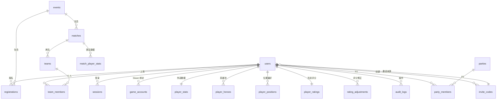

# HIVE · DATABASE

> 状态：V1.0 设计基线（已通过真实 SQLite 执行校验）
> 唯一真源：`packages/database/migrations/0001_init.sql`
> 本文解释"为什么这样建"，不重复罗列每一列——列定义请直接读 SQL。

## 1. 总览

19 张表、237 个列、44 个索引。相比 PRD 的 14 张，多出 5 张：

| 表 | 为什么必须存在 |
| --- | --- |
| `sessions` | 用不透明 token 换取"可撤销会话"。若把会话塞进 JWT，退出登录/踢人/改密码后旧 token 仍然有效，测试与线上都会踩坑 |
| `player_ratings` | PRD 已追加。把"当前评分"从 `users` 拆出，读写路径与档案解耦，且可整表重建 |
| `invite_codes` | V1.0 采用邀请制注册，且需要"谁邀请进来的"可溯源（`users.invite_code_id`） |
| `sync_jobs` | 免费版没有 Queues，异步任务需要一张 outbox 表承接（租约抢占 + 退避重试），详见 ARCHITECTURE §8 |
| `party_members` | `parties` 是多对多关系，缺它无法表达成员；P2 只建表不启用 |



`sync_jobs` 不参与 ER 关系：它的载荷是 JSON（`payload_json`），刻意不与业务表建外键——任务表要能独立清理，且被引用的行可能已被删除。

优先级：`users` `sessions` `game_accounts` `invite_codes` `player_stats` `player_positions` `player_ratings` `rating_adjustments` `events` `registrations` `teams` `team_members` `sync_jobs` `audit_logs` 为 P0；`matches` `match_player_stats` `player_heroes` 为 P1；`parties` `party_members` 为 P2。

## 2. 类型约定（D1 是 SQLite，不是 PostgreSQL）

| 项 | 约定 | 原因 |
| --- | --- | --- |
| 主键 | `TEXT`，UUIDv7 字符串 | D1 无 `UUID` 类型；UUIDv7 自带时间序，B+Tree 写入局部性接近自增 ID，且不像自增 ID 那样泄露规模 |
| 时间 | `INTEGER`，UTC Unix **毫秒** | 与 JS `Date.now()` 同构，前后端无需时区转换；展示层统一用 `Asia/Shanghai` |
| 布尔 | `INTEGER` 0/1，列名 `is_` 前缀 | SQLite 无 BOOLEAN |
| 枚举 | `TEXT` + `CHECK IN (...)` | 比整数枚举可读，迁移可审计 |
| JSON | `TEXT` 列，`_json` 后缀（PRD 锁定的 `*_snapshot` 除外） | D1 无 `JSONB`；写入前用 Zod 校验，读取时 `JSON.parse` |
| 比率 | `INTEGER` 基点 0..10000，`_bp` 后缀 | 避免浮点比较误差，展示时 `/100` 加百分号 |
| 外部 ID | `TEXT`（如 `dota_match_id`） | DOTA2 match_id 已超 32 位整型 |

SQL 里的时间默认值 `(CAST(strftime('%s','now') AS INTEGER) * 1000)` 只是**兜底**（秒精度）。业务写入必须显式传毫秒时间戳，否则同秒内的排序会不稳定。

## 3. 核心不变量（已用 SQLite 实例逐条验证）

这些是约束，不是"建议"。任何绕过服务层的写入都会在数据库层被拒绝：

| # | 不变量 | 实现 |
| --- | --- | --- |
| 1 | 最终评分 = `clamp(系统分 + 修正, 0, 1000)` | `player_ratings` 表级 `CHECK` |
| 2 | 同一用户在同一赛事只能有一条报名 | `ux_registrations_event_user` |
| 3 | 同一玩家不能同时出现在一场比赛的两个正选阵容 | `ux_team_members_match_user_active`（部分唯一索引） |
| 4 | 一支队伍的一个位置只能站一个人（候补除外） | `ux_team_members_team_position`（部分唯一索引） |
| 5 | 候补可以与其他候补重叠位置 | 上述两个索引均带 `WHERE is_substitute = 0` |
| 6 | SteamID64 必须是 17 位纯数字 | `CHECK (... NOT GLOB '*[^0-9]*')` |
| 7 | 候补报名必须有排队序号 | `CHECK (status <> 'WAITLIST' OR waitlist_position IS NOT NULL)` |
| 8 | 赛事容量必须是 10 的整数倍 | `CHECK (capacity % 10 = 0)`，从根上禁止"残缺比赛" |
| 9 | `PUBLISHED` 的比赛必须有发布时间 | 表级 `CHECK` |
| 10 | 评分修正必须有 ≥4 字符的原因，且新旧值不同 | `rating_adjustments` 表级 `CHECK` |
| 11 | 邀请码必须是大写规范形式（6..16 位 `[A-Z0-9-]`） | `invite_codes.code` 表级 `CHECK` |
| 12 | 邀请码使用次数不得超过上限（`max_uses = 0` 表示不限） | `CHECK (max_uses = 0 OR used_count <= max_uses)` |
| 13 | 同一去重键最多存在一条在途任务，防止重复同步 | `ux_sync_jobs_dedupe`（部分唯一索引，仅约束 PENDING/RUNNING） |
| 14 | 终态任务（DONE/DEAD）必须带 `finished_at` | `sync_jobs` 表级 `CHECK` |

## 4. 数据模型里最要紧的三件事

### 4.1 评分是三层，历史是只追加的

```
player_ratings.system_rating      ← 实力分（MMR ÷ 10），只有重算任务能改
player_ratings.admin_adjustment   ← 管理员改的，只有 rating 模块能改
player_ratings.effective_rating   ← 前两者相加并 clamp，冗余存储用于排序
player_ratings.attendance_bp      ← 出勤率（0..10000，NULL=无记录），独立于实力分
rating_adjustments                ← 每次修改一行，append-only
```

`attendance_bp` 只服务候补排序（出勤率 → 实力分 → 报名时间），**不参与** `system_rating` / 分队。它由 `recomputeUserRating` 随评分一起刷新；迁移 0010 先从旧 `breakdown_json` 回填，旧值则等每日维护或管理员「重算全部」。

为什么不在 `users` 上加一列 `rating`：`users` 是身份表，写入频率低；评分会被 Cron 批量重算、被管理员修正、被排行榜高频读取，混在一起会让"谁是权威数据"变得模糊。拆分后 `player_ratings` 可以整表删掉重算而不触碰任何身份信息。

`admin_adjustment` 的数据库 `CHECK` 放宽到 ±500，业务上限（默认 ±150）由 `env.ADMIN_ADJUSTMENT_LIMIT` 控制。这样"后台可调整修正上限"不需要改表结构。

### 4.2 快照是冻结的，永远不回写

两个层面各存一份快照，都带 `snapshot_at` 语义：

| 位置 | 字段 | 冻结时机 |
| --- | --- | --- |
| `registrations` | `system_rating_snapshot` / `admin_adjustment_snapshot` / `effective_rating_snapshot` / `position_snapshot` | 报名成功那一刻 |
| `team_members` | `system_rating_snapshot` / `admin_adjustment_snapshot` / `effective_rating_snapshot` / `position_fit_score` | 分组编辑器保存阵容时 |

规则：**管理员修正玩家评分时，只允许写 `player_ratings` 与 `rating_adjustments`，禁止 UPDATE 任何 `*_snapshot`。** 已公布的队伍实力因此不可被追溯篡改。

副作用（有意为之）：若管理员在分组后修正了评分，当前阵容的 `effective_rating_snapshot` 与 `player_ratings.effective_rating` 会出现差值。API 在读取阵容时返回 `ratingDrift`，由管理员显式选择"按新评分重新生成"或"沿用原快照发布"。

### 4.3 赛事 ≠ 比赛

- `events`：一次社区活动（如"第 01 期周末内战"），有报名窗口和容量。
- `matches`：活动内的具体场次，`(event_id, match_no)` 唯一。
- `teams` / `team_members`：某一场次的双方阵容。

报名 20 人 → 生成 2 场 `matches`；报名 16 人 → 1 场 + 6 人候补，**不会**生成缺人的比赛。分组算法每次只处理 10 人一场，V1.0 不做跨场次联合优化。

`events.capacity` 的语义是**目标人数**，不是座位数：`capacity = 20` 表示目标 2 场 × 10 人，`capacity % 10 = 0` 的 CHECK 保证目标场次永远整除。报名人数未满时全体 `CONFIRMED` 等待成局；封盘时由 `finalizeRoster()` 按 `floor(confirmed/10)` 切场次，余数才转 `WAITLIST`。

`teams.event_id`、`team_members.match_id` 是有意的冗余：赛事阵容页与"我的比赛历史"都靠它们省掉一次 join。

候补队列不按报名先后硬排：`registrations.waitlist_position` 由 `services/waitlist.ts` 按 **出勤率 → 实力分（报名快照）→ 报名时间** 重排（无出勤记录按 50% 中性值），报名、封盘转候补、候补转正、退赛后都调用。它只影响 `WAITLIST`，正选和分队不使用。

## 5. 索引策略

43 个索引，按访问路径而非"列看起来重要"来建：

- 唯一性：`users.username/email/qq_number`、`game_accounts.steam_id64`、`player_stats.user_id`、`player_ratings.user_id`、`matches(event_id, match_no)`、`dota_match_id`、`registrations(event_id, user_id)`。
- 列表页：`registrations(event_id, status, effective_rating_snapshot DESC)`——报名名单按实力倒序，一条索引覆盖过滤 + 排序。
- 排行榜：`player_ratings(effective_rating DESC)`。
- 历史：`team_members(user_id, match_id)`、`match_player_stats(user_id)`。
- 审计：`audit_logs(entity_type, entity_id, created_at DESC)`。
- Cron 扫描：`events(status, starts_at)`、`sessions(expires_at)`。

原则：**不做前缀索引合并游戏**。这个规模下索引带来的写放大可以忽略，读路径清晰比省一个索引更重要。

## 6. D1 的硬约束（会直接改变代码写法）

1. **没有交互式事务。** `BEGIN / COMMIT` 不可用。多写操作要么用 `db.batch([])`（D1 保证原子），要么设计成幂等可重试。分组保存、发布阵容、评分修正都必须走 batch。
2. **迁移由 wrangler 管理。** `wrangler d1 migrations apply` 维护 `d1_migrations` 表；不要用 `drizzle-kit push`。
3. **外键默认生效。** 迁移中如需重建表，先 `PRAGMA defer_foreign_keys = on;`。
4. **单库单写者。** 写入串行化；一次 batch 提交整个阵容（≤ 20 条语句）比 20 次单独写入快一个量级。
5. **SQLite 方言。** 无 `JSONB`、无 `UUID`、无 `ILIKE`、无 `now()`；用 `lower(col) = ?` 或列已规范化后直接比较。
6. **行数上限按查询计费。** 列表接口必须分页（默认 20，上限 100），禁止 `SELECT *` 无 `LIMIT`。
7. **没有 Queues（免费版）。** 长任务不得塞进请求路径，一律写 `sync_jobs` 后由 Cron 抽干；`payload_json` 是唯一不与业务表建外键的列。

## 7. 迁移规约

- 文件名：`NNNN_<verb>_<subject>.sql`，如 `0002_add_match_remake_flag.sql`。**只增不改**，已发布的迁移文件禁止编辑。
- 每个迁移必须能在空库上从头执行成功，也必须能在"已有生产数据"上执行成功；涉及列删除时先加废弃标记，两个版本后再物理删除。
- 不得在迁移里写业务数据（首个管理员由 `seed` 脚本创建）。
- 执行顺序固定：`local` → `staging` → 备份生产 → `production`。
- 生产迁移前：`wrangler d1 export hive --output backups/$(日期).sql -c packages/database/wrangler.d1.jsonc`。

## 8. 容量估算（15 人、每月 8 场）

| 表 | 年增量 | 5 年行数 |
| --- | --- | --- |
| `team_members` | ~960 | ~5,000 |
| `match_player_stats` | ~960 | ~5,000 |
| `registrations` | ~1,700 | ~8,500 |
| `sync_jobs` | ~500（每场 2~3 条，其余手动触发） | ~2,500 |
| `audit_logs` | ~3,000 | ~15,000 |
| 其余 | 各 < 1,000 | 各 < 5,000 |

全库 5 年不超过 30 MB，远低于 D1 免费额度上限。**不需要分库、不需要归档任务**；`AUDIT_RETENTION_DAYS`（默认 365）由每日 Cron 清理，纯粹是为了让后台列表页不越用越慢。

## 9. 校验脚本

```bash
python packages/database/scripts/check_schema.py   # 在真实 SQLite 上执行全部迁移 + 17 条不变量
python packages/database/scripts/check_parity.py   # SQL ↔ Drizzle 表/列/索引/外键目标一致性
```

两个脚本都不依赖 `node_modules`，可以直接进 CI 前置步骤。`check_parity.py` 会拦住"改了 SQL 忘了改 Drizzle"这类只有运行时才暴露的漂移。
