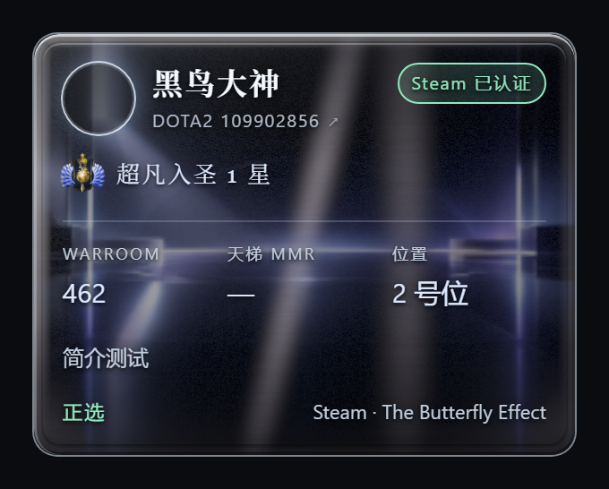
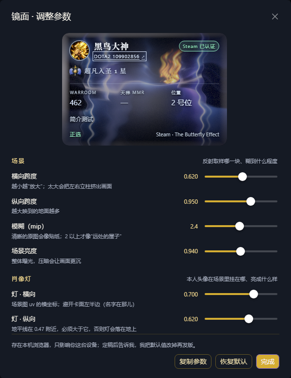

# HIVE · UI 设计基线

> 来源：界面概念图（品牌页 / 首页 / 赛事列表 / 赛事详情 / 玩家档案 / 管理后台 / 移动端）。
> 本文不是视觉稿复述，而是把概念图转成**实现契约**：每个页面读哪些接口、复用什么组件、哪些地方与现有 Schema 对不上。
> 取色为从截图目测的近似值，最终以设计源文件为准。

## 1. 设计语言

| 类别 | 取值 | 用途 |
| --- | --- | --- |
| 主色 `brand-600` | `#6C5CE7` | 主按钮（立即报名 / 发布阵容）、激活态、进度条 |
| 深底 `ink-800` | `#1E2235` | 顶部导航、后台侧栏、Hero 遮罩 |
| 页面底 `canvas` | `#F4F6FB` | 全站背景（卡片浮于其上） |
| 卡片 `surface` | `#FFFFFF` | 所有信息块，圆角 14px，阴影 `0 4px 16px rgba(30,34,53,.06)` |
| 正文本 `ink-700` | `#1B2033` | 标题 |
| 次文本 `ink-400` | `#64708A` | 时间、说明、表头 |
| 成功 `green` | `#2FBF71` | 报名中、在线、胜 |
| 警示 `amber` | `#F5A524` | 即将开始、候补 |
| 等级金 `gold` | `#E8B44A` | 排行榜前三、段位徽章 |
| 圆角 | 卡片 14 / 控件 10 / 胶囊 999 | |
| 字体 | 系统栈 + `-apple-system`；数字用 `tabular-nums` | 评分、比分、时间必须等宽，否则表格会抖 |

断点：`<640` 移动（单列，底部 Tab 栏）、`640–1024` 平板（双列）、`>1024` 桌面（三栏：品牌/内容/侧栏）。
桌面首页是"左品牌栏 + 中内容 + 右详情"的三栏布局，移动端折叠为单列 + 底部 5 Tab。

## 2. 信息架构与路由

导航只有五项：**首页 / 赛事 / 排行榜 / 战绩 / 我的**。账号类入口收进右上角用户名下拉：
**我的主页 / 账号设置 / 管理后台（仅 ADMIN 可见）/ 退出登录**。后台独立壳（同一 Worker 下 `/admin/*`）。

页脚三块：品牌与 slogan / 开发者与域名 / **数据来源 · Powered by STRATZ**（段位、天梯分与游戏昵称来自 STRATZ 的公开数据，外链 `stratz.com`）；底行是版权、免责声明与版本号（点开更新日志）。第三方数据必须署名，别只写"数据来自网络"。
底行还有一个 **QQ 群胶囊**（`QQ 群 826031703 · 复制`）：悬停 / 键盘聚焦 / 刚点过时，上方弹出二维码卡片；点击把群号写进剪贴板（`navigator.clipboard`，失败时退回 `textarea + execCommand`，非安全上下文也能用），状态从「复制」变「已复制」，失败则显示「请手动复制」——不弹 toast，是因为它就在页脚边角，弹窗的注意力成本更高。二维码图片是 `apps/web/src/assets/qq-group.png`（由 `docs/assets/qq.jpg` 裁剪+压色得到；那张源图扩展名是 `.jpg` 但字节是 PNG，换群时注意）。

| 路由 | 页面 | 权限 | 主要接口 |
| --- | --- | --- | --- |
| `/` | 首页 | 公开 | `GET /api/stats/summary`、`GET /api/events?status=REGISTRATION_OPEN&limit=1`、`GET /api/matches?limit=5`、`GET /api/leaderboard?limit=8` |
| `/events` | 赛事列表 | 公开 | `GET /api/events?status=&page=` |
| `/events/:id` | 赛事详情（4 Tab：信息 / 名单 / 分组 / 结果） | 公开 | `GET /api/events/:id`、`/registrations`、`/matches` |
| `/leaderboard` | 排行榜（评分 / 胜场；每行附带段位与 MMR） | 公开 | `GET /api/leaderboard?sort=rating\|wins` |
| `/matches/:id` | 比赛详情（含双方阵容） | 公开 | `GET /api/matches/:id` |
| `/records` | 战绩（Tab：全站 / 我的） | 公开 / 登录 | `GET /api/matches`、`GET /api/me/matches` |
| `/community` | 社区（**V1 只做玩家目录**） | 公开 | `GET /api/players?query=&position=` |
| `/players/:id` | 玩家档案 | 公开 | `GET /api/players/:id` |
| `/me` | 我的主页（评分 / 游戏身份 / 卡片外观 / 位置偏好） | 登录（页面自己提示） | `GET /api/me`、`GET /api/me/rating-history`、`PUT /api/me/positions`、`PUT /api/me/card-skin`、`PUT /api/me/rank`、`POST /api/me/game-account/claim` |
| `/settings` | 账号设置（个人资料 / 账号安全，`#profile` `#security`） | 登录（未登录跳 `/login?redirect=`） | `PATCH /api/me`、`POST /api/auth/password` |
| `/login` `/register` | 登录 / 邀请码注册 | 公开 | `POST /api/auth/*` |
| `/admin` | 仪表盘 | 管理员 | `GET /api/admin/dashboard` |
| `/admin/events` `/registrations` `/grouping` `/players` `/ratings` `/sync` `/audit` `/invites` | 后台七页 | 管理员 | 见 [API.md](API.md) |

后台侧栏九项与接口的对应：仪表盘 / 赛事管理 / 报名管理 / 智能分组 / 玩家管理 / 评分管理 / 数据同步 / 操作日志 / **系统设置**。
**系统设置 V1.0 不实现**（没有需要运营调的东西：修正上限、迭代次数都是 env）。侧栏该位置直接去掉，避免点进去是空页。

### 2.1 为什么「我的主页」和「账号设置」分成两页

拆分的依据是**改动频率**和**改错后果**，不是功能分类：

| | 我的主页 `/me` | 账号设置 `/settings` |
| --- | --- | --- |
| 内容 | 评分、游戏身份、卡片外观、位置偏好 | 显示名 / QQ / 简介、密码 |
| 频率 | 每场打完都可能来看一眼、点两下 | 半年动一次 |
| 心态 | 改错了不心疼（卡面点一下即生效） | 改错了要吃亏（登录凭据） |
| 编辑方式 | 点击即保存 / 就地保存 | 填完按「保存」 |

混在一页时，换一张卡面要滚过三个密码框；密码框和卡面挤在同一屏，也容易让"我只是想看看"变成误触。

几条边界：

- **评分、段位、位置偏好不接受玩家自己填**（评分归算法和管理员，段位来自 Steam/OpenDota 或由服务端按天梯分折算），所以它们属于"档案展示"，不是"设置项"。
- **游戏身份的只读信息和写操作分开**：徽章、DOTA ID、游戏昵称、段位常驻展示；绑定 / 重新认证 / 解绑 / 数字 ID 拉取 / 手动段位都收进「管理身份」折叠区。没验证过时默认展开——新用户第一件事就是绑 Steam 或填段位，藏起来等于没有。
- **位置偏好不做防抖自动保存**：志愿必须从第 1 志愿连续填写，中途状态（把 1 号位改成「不打」、2 号位还没提上来）是非法数据，自动提交只会把半成品写进库；改成显式保存 + 「有未保存的改动」标记 + 离开页面时确认。
- **`/settings` 走登录守卫**（游客进来什么也做不了，跳 `/login?redirect=` 并回跳），`/me` 不守卫（未登录时页面自己显示「请先登录」，跳走反而突兀）。

> 待办：`/community` 玩家目录和 `/players/:id` 公开档案还没做。做完之后 `/me` 的只读部分可以抽成 `PlayerProfile` 复用——
> 现在"我的主页"只有自己能看，缺了"别人眼里的我"这一半对照。

## 3. 组件清单（按复用度排序）

| 组件 | 出现位置 | 关键约束 |
| --- | --- | --- |
| `PageBack` | 后台各子页、账号设置、赛事详情、比赛详情、玩家详情 | 统一放**标题上方左侧**（`.page-back` + `.back-link`，见 styles-ui.css）；文案「返回 + 目的地」。别再手写 `← xxx` 的内联链接——三种样式两种位置就是这么来的。**返回去哪**分两种：只有上级入口的页（后台子页、账号设置、赛事详情）写死 `to` + `label`；能从任意入口进来的详情页（玩家详情：排行榜 / 赛事报名名单 / 评论区 / 我的主页都能点进来）传 `back`，先回浏览器历史的上一页，站外直接打开时才回落到 `to`。目的地文案由 `lib/back.ts` 按上一页路径推（`/leaderboard` → 「返回排行榜」），推不出来才写「返回上一页」 |
| `StatusPill` | 赛事卡、详情、列表 | `event.status` → 文案/颜色映射见 §4；`VOID/CANCELLED` 必须是灰色而非红色，避免"大家都在犯错"的错觉 |
| `EventCard` | 首页、赛事列表、详情侧栏 | 三种 CTA 态：立即报名 / 加入候补 / 查看详情；`DRAFT` 状态对普通玩家不可见。**时间条**并排显示「报名截止 / 开赛」：报名期截止那格是主角（金色 + 倒计时，<24h 转琥珀），封盘后换成开赛时间；没填的时间显示「待定」而不是隐藏。标题旁有**服务器标签**（国服琥珀 / 全球服绿）+ 「?」说明怎么进对服，文案统一在 `lib/server.ts` |
| `StatCard` | 首页四宫格、后台四宫格 | 数字等宽；`null` 显示 `—` 而不是 `0`（"0 场比赛"和"没数据"是两件事） |
| `RatingBadge` | 档案、排行榜、分组卡 | 显示 `effective_rating`，hover 展开三层（系统分 / 修正 / 最终），与 PRD 的可解释性要求对应 |
| `ProgressBar` | 赛事卡 `16 / 20` | 满员后转 amber；**同时显示"再需 N 人成局"**（见 §5.1） |
| `LeaderboardTable` | 首页 Top 8、排行榜页 | 名次用奖牌图标前三；评分列右对齐；胜率列显示基数（`78%（23 场）`），否则 1 胜 1 负会排到第一。**段位与 MMR 同占一列、上下两行**（拆两列窄屏会溢出）；排序仍只按评分或胜场——段位是评分的输入，不是结果 |
| `HeroPoolGrid` | 档案 | 6 张英雄卡 + 胜率；英雄图标缺图时用首字母占位，禁止空白格 |
| `MatchHistoryList` | 档案、战绩页 | 行内展示 `K/D/A`、`评分`、胜负色条，不展示"32:28"这类比分（DOTA2 没有总分概念） |
| `LineupBoard` | **后台智能分组**（核心） | 两列五槽；拖拽交换；每槽显示玩家名、评分、位置号、契合度；顶部实时显示双方总分与分差 |
| `PlayerChip` | 分组、报名名单 | 头像 + 昵称 + 位置徽章；候补态加半透明与 `候补` 标签 |
| `PlayerAvatar` | 赛事报名名单（列表视图）等紧凑列表 | 圆形头像，**没有地址或加载失败时整块不渲染**（与玩家卡一致，不留破图框）。错误状态按行各自记：不能用内联 `onerror`，CSP 的 `script-src 'self'` 会把内联处理器一起拦掉 |
| `RosterViews`（页面内） | 赛事详情「报名玩家」 | 默认**卡片**；右上角 `NTabs` 切「卡片 / 列表」。两种视图共用同一份 `/events/:id/registrations` 数据，列表列必须与卡片字段一一对应（序号、玩家、DOTA2 ID、验证、段位图标 + 段位文字、WARROOM、天梯 MMR、位置、正选/候补、Steam 昵称、简介），不要为列表另算一套。列表样式对齐排行榜：`.card`（`padding: 8px 12px`）包住 `.table-wrap` + `.table`，白卡片底、`.th-sort` + `.sort-arrow`，序号列 48px。**排序只在正选/候补各自组内生效**（`lib/roster.ts`），否则高分候补会跑到正选前面。简介超过 24 字给「展开 / 收起」原地变多行（`title` 只是兜底，不能当唯一手段） |
| `VerificationBadge` | 档案、玩家卡、分组编辑器 | 四态见 ARCHITECTURE §5.3：绿「已认证」/ 蓝「已验证·段位未公开」/ 黄「数据已校验·归属未验证」/ 灰「自报」。**灰色不是羞辱，是诚实**——配一句 hover 说明"该玩家未验证账号归属，实力仅供参考"；评分旁边同时显示 `±N` 不确定度 |
| `EmptyState` / `Skeleton` | 全站 | 列表空态必须给下一步动作（"还没有赛事 → 创建赛事"） |

## 4. 状态到界面的映射

| `event.status` | 文案 | 色 | 玩家可见 CTA |
| --- | --- | --- | --- |
| `DRAFT` | 草稿 | 灰 | 不可见 |
| `REGISTRATION_OPEN` | 报名中 | 绿 | 立即报名 / 加入候补（满员）/ 已报名 |
| `REGISTRATION_CLOSED` | 报名截止 | 蓝 | 等待分组 |
| `PUBLISHED` | 阵容已发布 | 紫 | 查看分组 |
| `COMPLETED` | 已结束 | 灰 | 查看结果 |
| `ARCHIVED` / `CANCELLED` | 已归档 / 已取消 | 灰 | 只读 |

`match.status`：草稿（仅管理员）、已发布、进行中、已完成、流局。

`registration.status`：`CONFIRMED` 正选（绿）/ `WAITLIST` 候补（蓝，带候补序号）/ `WITHDRAWN` 已退赛（灰）。
退赛的行**保留在库里**（重新报名会复用同一行，见 `POST /api/events/:id/registrations`），但它不在名单里：公开接口直接过滤掉，管理员页也只显示「N 人已退赛」的计数（悬停看是谁），表格里不占行、不占名额。状态文案走 `regStatusLabel()` 的映射表，**不要把英文枚举直接甩到界面上**（踩过：表格里出现过裸的 `WITHDRAWN`）。

## 5. 概念图暴露的三个设计问题（必须先定规则）

### 5.1 `capacity` 的语义：目标人数，不是座位数 ← 先钉死这个

`16 / 20` 的含义已确认：`capacity = 20` 表示**目标 2 场 × 10 人**，16 人已报名、还差 4 人凑满，**全体处于等待成局**，不是"10 人先打、6 人轮空"。

这一定义连带决定了几条规则：

| 概念 | 定义 | 实现 |
| --- | --- | --- |
| `targetMatches` | `capacity / 10` | 派生，不建字段 |
| 报名人数 | `status = CONFIRMED` 的计数 | |
| 等待成局 | `REGISTRATION_OPEN` 且未满 | **UI 文案，不是状态** |
| 可开赛场次 | `floor(confirmed / 10)` | 派生 |
| 候补 | 封盘后超出「可开赛场次 × 10」的余数 | `finalizeRoster()` 一次性写入 `WAITLIST` |

1. **报名期不生成比赛。** 即使已够 10 人也不开，否则先报名的人先打、后报名的干等，排期必乱。要提前开，走「提前封盘」。
2. **封盘时一次性结算**（`finalizeRoster()`）：按可开赛场次切分，余数转 `WAITLIST` + `waitlist_position`。这就是"不自动创建残缺比赛"的落地方式。
3. **人数不足一场（< 10）**：不生成比赛，停在 `REGISTRATION_CLOSED`，后台提示二选一——延期 / 取消。
4. **人数卡在两档之间（如 16 人、目标 2 场）**：**必须把选择权交给管理员**，不许静默生成 1 场：
   - 「按 16 人开 1 场，6 人候补」；
   - 「延长报名 2 小时，凑第 2 场」。

   这两个选项对社群的影响完全不同（一个让 6 个人今晚没得打，一个让到场的人多等两小时），系统没有资格替他们选。`AUTO_FINALIZE_ODD` 默认 `false`。
5. **允许提前封盘**：满 10 人后管理员可随时关闭报名。在小社区里，"等第 20 个人"经常等于"这周不打"。

`slotsToNextMatch = 10 - (confirmed % 10)`，为 0 时表示刚好凑满一场；满员时为 `null`。前端显示 `16 / 20 · 再需 4 人开第 2 场`。

概念图在**报名中**就展示了「候补名单 3」——按此模型，报名期的候补只应出现两种情况：超出 `capacity` 的排队者，或已经封盘。否则会让 16 人里原本没被刷的人以为自己被刷了。建议报名中只展示「已报名 16 / 目标 20」，候补区在封盘后才出现。

#### 超额时谁上场：有段位 → 评分 → 报名时间

15 人报名、只能开 1 场（10 人）时，挑选顺序固定为：

| 序 | 键 | 为什么 |
| --- | --- | --- |
| 1 | **有段位信息**（`rank_tier` 或自报 MMR 非空） | 没有段位的人实力分只有 500 中性值。让这个中性值压过真打了 450 分的人，等于奖励"不填资料" |
| 2 | `effective_rating_snapshot` 降序 | 报名时冻结的评分，事后改评分不影响已封盘的结果 |
| 3 | `created_at` 升序 | 同分先到先得 |
| 4 | `id` | 兜底，保证同一批数据排出同一顺序 |

落地方式：

- **不设硬门槛**——没有段位照样能报名、能被选上，只是排在后面。硬拦会把新人挡在门外。
- 报名前弹一次确认框，把后果说清楚（"人多了你可能上不了场"），并给一键跳转「我的主页 → 游戏身份」的入口。
- 「有没有段位」是**封盘时实时查** `player_stats`，不是报名快照：报名后补上段位，封盘时就算数。
- 正选名单的 SQL（`admin-events.ts` 的 `START_PARTIAL`）与 `compareForSelection()` 必须逐键一致，改一处就得改另一处。
- 候补队列仍按「出勤 → 实力 → 报名时间」（`services/waitlist.ts`），不套用上表——补位看的是可靠性，不是资料完整度。

#### 位置偏好少于 3 个：同一套「软门槛」

分队永远要把 1–5 号位填满（`balanceTeams` 里每个位置都会算契合度，没有偏好只是契合度低），所以志愿少于 3 个的人，剩下两个位置等于交给算法「随便塞」。处理方式和段位一致——不拦人，但报名前必须把后果说清楚：

| 档案状态 | 报名页提示 | 报名时 |
| --- | --- | --- |
| 0 个位置偏好 | 「位置未知，容易被排到任意位置」+ 去补全 | 先弹「还没有位置偏好」确认框 |
| 1–2 个 | 「只填了 N 个——少于 3 个时可能被挪到没填过的位置」+ 补到 3–5 个 | 先弹「位置偏好只有 N 个」确认框 |
| 3–5 个 | 无 | 直接报名 |

- 两个确认框都只有「去补 / 仍然报名」两个选择，入口分别是 `/me#game-identity` 与 `/me#positions`；都没填时按「段位 → 位置偏好」的顺序问（第一个放行后接着问第二个）。
- 「位置偏好」编辑器保存按钮旁常驻 `已选 N 个`，少于 3 个时追加一句琥珀色提示——让人在改偏好时就知道，而不是等到报名才看见。
- 不设硬门槛：硬拦会把只玩一个位置的新人挡在门外，而算法本来就有 fallback。

### 5.2 MVP 排行没有数据源

排行榜有 **战力 / 胜场 / MVP** 三个 Tab，但 `match_player_stats` 只有 K/D/A、GPM 等原始字段，没有 MVP。DOTA2 的赛后 MVP 也不在 OpenDota 的标准返回里。

两个选择：

1. **派生（推荐，零迁移）**：定义 `performanceScore = 0.35×KDA系数 + 0.25×GPM系数 + 0.2×英雄伤害系数 + 0.2×参战系数`，每场取最高者为 MVP。规则写在服务层，`match_player_stats` 不动。缺点：是我们自己定义的 MVP，不是官方 MVP。
2. **加列（要迁移）**：`match_player_stats.is_mvp INTEGER`，从 STRATZ 或人工录入。数据更"权威"，但引入对新数据源的依赖。

在没有导入比赛数据之前，这个 Tab 应展示空态"暂无赛后数据"，**不要用假数据填充**。

### 5.3 导航里的"社区"是范围蔓延的入口

"社区"最容易被理解成动态流/发帖/评论——那是另一个产品。V1.0 建议只做**玩家目录**（卡片墙：头像、段位、评分、位置、胜率），复用 `GET /api/players`，不新增任何表。

同理，"战绩"页 = 近期对局列表 + 我的对局，复用 `matches` 与 `team_members`，也不需要新表。

另外两处小问题：赛事列表的 **"全部模式"筛选**在 V1 只有一种模式，应隐藏（否则是永远只有一项的下拉框）；**"胜利 32 : 28"** 不要做成比分——DOTA2 没有总分，应显示"胜方 + 时长 + 关键数据"。

## 6. 关键交互的实现约定

- **拖拽换队**：整份 `moves` 提交（不是逐格 PATCH），带 `version` 乐观锁；失败时 `409` 并回滚到服务端状态，同时提示"阵容已被其他管理员修改"。拖拽过程中本地实时重算总分与位置冲突，**保存后以服务端返回为准**（前端算的只用于即时反馈）。
- **分组页轮询**：`15s`，`document.hidden` 时暂停；不做 WebSocket。
- **报名按钮**：点击后乐观置为"已报名"，失败回滚并 toast；重复点击由唯一索引兜底（`CONFLICT`）。
- **评分修正**：表单必须填原因（≥4 字），提交后展示"修改前 → 修改后"确认弹窗——这是唯一能改变玩家长期档案的操作，值得多一次点击。
- **图片资源**：DOTA2 英雄头像/载入图版权归 Valve，社区内部使用；建议把素材走 `public/assets` 静态托管，不引 R2。缺失时用首字母占位，不允许空白。

## 7. 与现有实现的差距清单

| 项 | 现状 | 需要做的 |
| --- | --- | --- |
| `GET /api/stats/summary` | 未定义 | 首页四宫格（成员数、累计比赛、本月参赛、最佳玩家），一条聚合 SQL |
| `GET /api/leaderboard?sort=` | 只有评分排序 | 增加 `wins` / `mvp` 两种排序与 `winRate` 字段 |
| `GET /api/me/matches` | 未定义 | 战绩页"我的对局" |
| 候补派生逻辑 | 规则未定 | 按 §5.1 定稿后写入 API 与分组服务 |
| MVP 计算 | 无 | 按 §5.2 方案 1 在服务层实现 |
| 系统设置页 | 概念图有 | V1 不做，侧栏删除 |

以上除"候补规则"外都不需要迁移；候补规则本身也能靠派生视图实现，同样不动表结构。

## 8. WARROOM Rating 浮窗（`RatingExplainer`）

玩家档案、排行榜、分组编辑器里只要出现评分数字，就必须能解释它。**一个没人看得懂的分，玩家只会当成黑箱并拒绝接受分队的结论。**

### 8.1 交互规格

| 项 | 规则 |
| --- | --- |
| 触发 | 桌面端 hover 300ms 后展开（防误触）；移动端点头部即可，因为没有 hover |
| 关闭 | 移出 / `Esc` / 点击浮层外 |
| 定位 | `position: fixed` 的浮层，**不能塞在卡片内部**——卡片一律 `overflow: hidden`，会被裁掉 |
| 无障碍 | 触发元素可 Tab 聚焦，`aria-describedby` 指向浮层内容，`Esc` 关闭后焦点回到触发元素 |
| 加载 | 数据必须随页面一起返回，**hover 时不发请求**。发请求的浮窗在弱网下等于没有 |
| 两种形态 | `static`（纯规则说明，用于排行榜等无明细场景）与 `personal`（带该玩家的实力 / 出勤明细） |

### 8.2 文案（可直接复制给前端）

**标题**：WARROOM Rating 是什么？

**首段**：

> 这是 HIVE 用来分队的内部评分，范围 0–1000。**实力分 = 天梯 MMR ÷ 10**；它只回答一个问题：**在这 15 个人的社区里，怎么分队两边才更接近。** 出勤不进入这个分，只决定候补顺序。

**当前 v3 构成**（带该玩家的实际得分）：

| 项目 | 上限 | 看什么 |
| --- | --- | --- |
| 实力分 | 1000 | 天梯 MMR ÷ 10；没有 MMR 时用勋章/星级估算，两者都没有给 500 中性值 |
| 出勤 | 不占分 | 报名且赛事结束后实际出场占比；**只影响候补顺序，不影响实力分和分队** |

**置信度说明**（仅当置信度 < 1 时显示）：

> 这个百分比表示天梯样本的充足程度，只影响展示的不确定度和管理员可修正范围；**不会再把你往 500 拉**。打够约 300 局后置信度到 100%。

**管理员修正**（仅当修正值 ≠ 0 时显示）：

> 管理员根据社区实战认知调整了 **{+50}** 分。每次修正都必须填写原因，历史记录不可删除。
> ——修正幅度会随数据可信度放宽：数据越少，管理员能动用的范围越大（最多 ±500）。

**未验证提示**（仅当徽章非绿色时显示）：

> 该账号归属未经验证（只填写了数字 ID 或手动填写段位），分数可能存在偏差，显示为 **720 ±90**。

**页脚**：

> 算法版本 `warroom-v3.1` · 更新于 {时间} · 参考天梯约 {4,300} 分 · 出勤 {80%}

### 8.3 三条实现约束

1. **数字全部来自接口**（`GET /api/players/:id` 的 `rating` 对象），前端只做格式化，**不允许在展示层重算或四舍五入后再拼接**——否则浮窗上的分和数据库里的分迟早对不上。
2. **修正原因的可见性**：本人与管理员可见完整原因；其他玩家只看到"管理员修正 +50"，看不到原因。原因里可能写着"水平明显虚高"，公开等于当众评价。
3. **快照要单独说明**：浮窗里注明"报名与分队时会冻结当时的评分，之后调整不影响已公布的阵容"。这句话能省掉 90% 的争议。

## 9. 提示信息统一机制（`HelpTip`）

全站只有一种"说明性文字"的呈现方式：**标题旁边的「?」，点开/悬停展开浮窗**（标题 + 步骤 + 虚线备注）。
不再往页面里塞整段的灰色说明——它们会把真正要看的数据挤到屏幕外。

| 项 | 规则 |
| --- | --- |
| 收进浮窗 | 规则、算法、身份验证方式、"为什么这么设计"这类**静态**文字 |
| 留在页面 | 随数据变化的警告（人数不匹配、报名已关闭、志愿跳档）与操作反馈（错误/成功/toast） |
| 挂载位置 | 章节标题 `h1.section-title`、卡片标题 `.card-title`、字段标签 `.field-label`；都没有时补一行小标题，不新造样式 |
| 组件 | `apps/web/src/components/HelpTip.vue`；样式在 `styles-theme.css` 的 `.help / .help-pop`，深色浅色各一套 |
| 写法 | `<HelpTip title="…" :steps="['① …','② …']" note="…" />`；长内容加 `wide`（400px）；需要链接/加粗时用默认插槽 |
| 交互 | hover 或键盘聚焦展开；`Esc` 收起；展开前按视口宽度收敛 `--pop-shift`，贴边也不会被切掉 |

约束：浮窗是绝对定位，祖先不能有 `overflow: hidden`（当前 `.card` 没有）。若以后给卡片加裁切，必须把浮窗改成 `position: fixed` 或走 Teleport。
评分卡的浮窗文案要与**当前算法**一致（v3 = 实力分 MMR ÷ 10 + 出勤独立、只影响候补）；§8 里早期 PRD 的五项概念未实现，不要照抄。

### 10.1 HolographicSticker（全息贴纸组件）

pps/web/src/components/HolographicSticker.vue，五层结构：ase 深色金属底板 / oil 虹彩薄膜 / acets 微晶切面 / sheen 镜面高光带 / 
im 金属外框 / gloss 树脂柔光。层与层全部 position: absolute，组件自带 order-radius + overflow: hidden。

| prop | 默认 | 说明 |
| --- | --- | --- |
| intensity | 0.9 | 0..1，薄膜与切面的整体不透明度 |
| interactive | true | 跟随鼠标改反射中心与高光角度 |
| 
im | true | 是否画金属外框（当卡片背景时关掉，用卡片自己的描边） |
| 
adius | 14 | 圆角，可传数字或 '50%' |
| surface | false | 铺满父容器（卡片背景用法） |

CSS 变量：--foil-light-x / --foil-light-y / --foil-angle / --foil-intensity / --foil-radius，默认值在组件 <style scoped> 顶部。

用法：

`ue
<!-- 卡片背景 -->
<HolographicSticker surface :rim=false :intensity=0.95 />
<!-- 独立徽章 -->
<HolographicSticker :radius='50%'><span class=badge-text>TI 2023</span></HolographicSticker>
`

## 10. 玩家卡片皮肤（材质 / 边框）

玩家卡不是固定皮肤：每个账号在「我的 → 卡片外观」里自选材质 + 边框，报名名单里所有人看到的就是他自己选的那套。
两个基础维度是**正交**的，一共 8 × 8 = 64 种组合；发丝线 / 双线另外各带 8 种颜色 × 3 种光效。
「无限镜」和「镜面」是**创始人专属**的第 8、第 9 种材质：只对 `users.is_founder = 1` 的账号出现在选择器里，
且 `PUT /api/me/card-skin` 会对着一个人再校验一次（手搓请求 403）——前端藏入口不是权限。

> 名字下面那行 `DOTA2 109902856 ↗` 是玩家的数字 ID（绑定 Steam 或声明数字 ID 才有），点开直链 STRATZ 公开资料（新窗口，且**不**触发卡片的跳转——赛事页整卡是链接，这个锚点用 `@click.stop` 拦住了冒泡）。它的用途是**让别人核对**段位与战绩，不是装饰；对方没开「公开比赛数据」时第三方也查不到，徽章会停在「自报」。

| 维度 | 取值 | 负责什么 |
| --- | --- | --- |
| `material` 材质 | `basic` 默认 / `pixel` 像素 / `acrylic` 亚克力 / `sparkle` 闪耀 / `holo` 全息 / `gold` 金色 / `psi` 灵能 / `infinity` 无限镜（创始人专属）/ `mirror` 镜面（创始人专属） | 底色、纹理、**整套字色**（正文 / 次要 / 强调 / 语义色）；`gold` / `pixel` / `psi` / `infinity` 的卡面由 canvas 程序化渲染（`apps/web/src/lib/metal.ts` / `pixel.ts` / `psi.ts` / `infinity.ts`），随倾斜重绘；`mirror` 走 **WebGL2**（`lib/mirror.ts`），渲完贴回同一个 `.pcard-surface` canvas |
| `frame` 边框 | `hairline` 发丝线 / `none` 无边 / `double` 双线 / `corners` 四角 / `bevel` 浮雕 / `frost` 霜线 / `spark` 电光 / `arc` 雷纹 | `none` / `bevel` 是静态 CSS；`corners`/`frost`/`spark` 走 **GPU 合成**（`components/CardFrameFX.vue` + `styles-frame-fx.css`，只动 transform / opacity）；`arc` 仍是逐帧动画 WebP（480×398，`apps/web/scripts/make_border_anims.py` 生成） |
| `frameColor` 颜色 | `auto` 跟随材质 / `gold` 鎏金 / `ice` 霜蓝 / `cyan` 电青 / `violet` 灵紫 / `rose` 霓虹 / `emerald` 翡翠 / `rainbow` 流动彩色 | **只对发丝线 / 双线生效**；`auto` 吃材质自己的 `--skin-border`，其他值覆盖描边与光晕，`rainbow` 是旋转的 conic-gradient |
| `frameEffect` 光效 | `steady` 常亮 / `breathe` 呼吸 / `blink` 闪烁 | 只对发丝线 / 双线生效；只动整层 `opacity`。`rainbow` 自带色相旋转，光效叠加在它上面 |

> 旧的全局特效（流光 / 星尘 / 扫描 / 呼吸，`users.card_effect`）已在迁移 0007 整条下线；现在的 `frameColor` / `frameEffect` 是**边框配色**，不是当年那套全卡特效，迁移 0009 只加两列，不恢复 `card_effect`。

实现约定：

1. **组件不认识皮肤**。`PlayerCard` 只输出 `data-material` / `data-frame` 两个属性，样式全在 `styles-skins.css` 里换 CSS 变量（`--skin-bg` `--skin-text` `--skin-muted` `--skin-accent` `--skin-accent-2` `--skin-ok` `--skin-warn` `--skin-info` `--skin-idle` `--skin-body-shadow` `--skin-divider` `--skin-radius` `--skin-shadow` `--skin-tex` `--skin-tex-size` `--skin-tex-repeat` …）。
2. **两种材质用生成的 SVG 贴图**：`apps/web/src/assets/card-sparkle.svg`（碎钻晶面 + 星点）与 `card-gold.svg`（流动金箔）。CSS 渐变再做不出参考图里的不规则碎面，就用固定种子的脚本生成后当成静态资源提交；改纹理只需要重跑生成脚本。其余材质仍是纯 CSS 渐变。
3. **材质自带配色，不随主题翻转**。金卡在浅色主题下仍然是金卡；`basic` 与 `acrylic` 才跟随深浅主题各写一套。因此**不要**在 `:root[data-theme='light'] .pcard` 上写 `--skin-frame-bg` 这类材质令牌——那会给深色材质糊一层白雾（踩过）。
4. **换材质 = 换整套文字配色**：每个材质在自己的块里给全 `--skin-text` / `--skin-muted` / `--skin-accent*`，以及 `--skin-ok`（正选 / 已认证）/ `--skin-warn`（候补）/ `--skin-info` / `--skin-idle` 四个语义色。徽章底色用 `color-mix(in srgb, currentColor 16%, transparent)` 从当前文字色兑出来，所以**不要**再写 `[data-material='xxx'] .badge-ok { color: … }` 这种逐材质的补丁——亮材质压深、暗材质提亮，全部在材质块里一次给完。笔画比较花的底（亚克力 / 全息 / 灵能）再加一层 `--skin-body-shadow` 描边。
5. **视差层（闪耀 / 全息 / 金色）**：`PlayerCard` 额外渲染一个 `.pcard-depth`，材质在里面用 `::before` / `::after` 再画 1~2 层同款图案，位移量取自指针归一化值 `--px` / `--py`（-1..1），每层方向和幅度不同（如闪耀：晶面层 −18px、星点层 +30px）。卡片倾斜时图案之间互相错位，就有了"图案有厚度"的错觉；指针离开即归位。
   - 全息的微晶切面是**程序化渲染**的：`apps/web/src/lib/holo.ts` 里每个三角面带一个扰动法线，用半程向量算镜面强度、用倾斜量 + 法线朝向算衍射色相，canvas 逐帧重画；所以倾斜时颜色真的从蓝紫滑到黄绿（同一张贴纸在不同角度的照片就是这样），不是贴图平移。色相同时写回 `--foil-hue`，金属外框跟着一起变色。
   - 全息是五层结构（`HolographicSticker`）：深色金属底板 / 虹彩薄膜 / 微晶切面 / 金属外框 / 透明树脂。切面与高光带按 `--px` / `--py` 以不同幅度位移。
   - 金色的"反光"是两道错速滑动的镜面亮带（亮带紧跟一条暗带）+ 跟着指针的聚光 + 底边压暗，配上错位的金箔副本才有折射感。
   - 注意：`.pcard-depth` 带 `transform`，自成层叠上下文，**不要在它的伪元素上用 `mix-blend-mode`**（只会和透明底混合，等于白写）；`will-change` 也只在 `.is-active` 时挂，避免名单页十几张卡常驻合成层。
   - **无限镜（`lib/infinity.ts`）**是唯一真按**三维光廊**渲染的材质，不是同心方框的 2D 近似：
     - 截面是一个圆角矩形（半宽/半高直接取自卡片，圆角按比例），沿 +Z 一层层复制。每层在空间里**尺寸相同**，看起来变小只是透视（`k = f/z`），所以**宽高比永远等于卡片**；
     - 层与层之间铺**内壁**（16 段四边形）。内壁不透光，于是**近层挡住远层**——视角越斜、能看到的层数越少（这是真实遮挡关系，不是靠透明度装的）。画法是从最里面一层往外画（画家算法）；
     - 亮度按反射次数指数衰减（`REFLECTANCE = 0.9`，每次反射损失光），宽度跟着透视缩，所以越深越暗；`0.9^i < 0.015` 就停止绘制；
     - **越深越糊**：按深度分三段（0.34 / 0.62 两个分界），每段先画到离屏画布、再用 `ctx.filter = blur()` 整体合成回来（3 次滤镜，不是每层一次——几百个图元逐个过滤镜会卡死）。深处那一段还额外压 `globalAlpha`（模糊会把几十圈光晕堆成一团白，不压中央过曝）。**只压亮度不模糊是不够的**：远层仍然是锐利的线稿，不像光的残影（踩过）；
     - 相机与卡片共用一套变换：绕**卡面中心**先偏航再俯仰，所有层（包括最外层）用同一个投影矩阵。**角度严格等于卡片自己的 CSS 倾斜（±13°/±11°）**，内部光廊就是同一视角下的三维空间；不要让内视角比卡片转得更大，否则看着像"卡片小转、内景大转"。
     - **符号要当心**：本文件的 +Z 是"往画面里"，CSS 的 +Z 是"朝观看者"，同一个旋转矩阵在两套坐标里视觉效果正好镜像。所以偏航要取反（`yaw = -tiltX * MAX_YAW`）、俯仰取正；反了就是"卡片右转、内景左转"（踩过）。判断方向对不对的笨办法：指针压到右边，卡片右边缘后退，廊道尽头应该往**左**偏。
     - 尽头那道光是**最远的元素，必须最先画**，否则斜看时会浮在近壁上（一眼假）；位置取该层中心的投影，不要拿某个角点当中心。
     - 画布尺寸每帧按 `clientWidth/clientHeight` 重算。实测（headless，无 GPU）真实卡片 340×233 下中位 16.6ms / p90 17.9ms；故意放大到 640×560 是 20.5 / 34.5ms（界面里没有这么大的卡，只当压力参考）。
    - **镜面（`lib/mirror.ts`）是全站唯一用 WebGL2 的卡面**，也是唯一一条"着色器 + 2D 回贴"的管线：
      - 全站**只有一个** WebGL2 上下文（离屏 canvas，`preserveDrawingBuffer: true`）：渲完一帧立刻 `drawImage` 贴回卡片自己的 `.pcard-surface`（2D canvas）。报名页十几张卡不会各开一个上下文（浏览器大约 16 个就开始丢最老的），也保住了"WebGL2 不可用时退回 2D 渐变"这条退路——同一个 canvas 不能换上下文类型，所以卡片侧永远坚持 2D。
      - 板面法线 = 横向曲率略大于纵向的微弯（`p × 0.40 / 0.18`）+ 低频拉丝。**纵向曲率必须小**：纵向一弯，场景里的竖线（立柱、平台边）会被拧成波浪，看着像贴图被揉皱了（踩过）。
      - **反射的内容是一张打包进前端的虚拟场景**（`assets/env-stage.webp`，1024×576，16KB）：深蓝展厅、一条地平线灯带、左右两根立柱、下半部分是抛光地面。按 `uv = 0.5 + R.xy × (0.62, 0.95)` 取样——场景图是平面幕布而不是等距柱状全景，这个映射等于"远处的一面墙"，指针一动整张图就在板面上滑。
      - **必须取高 mip（`textureLod(..., 2.4)`）**。清晰的原图反射上去像贴纸，而且会和卡片上的文字抢对比度；糊了才像"远处的屋子映在金属上"。
      - **本人头像作为场景里的一盏"肖像灯"**（`AVATAR_SPOT`，uv `(0.7, 0.62)`，半径 0.11）。位置有两条硬约束：必须在 `uv.y > 0.47`（地平线以上，否则就是"地上摊着一张会发光的画"）；横向必须避开卡面左半边（名字和头像都在那儿，灯放过去会把大标题压糊）。
      - 头像用 `max()` 而不是直接替换合成：头像大多偏暗，直接盖会在板面上砸出一个黑洞，只允许它"提亮"才像灯。外面再叠一圈**暖色灯罩**——整间屋子都是冷蓝的，唯一一处暖光就是"你"，这也是全局里唯一能一眼找到头像的线索。
      - **头像的 CORS 已经验明**：`avatars.steamstatic.com` 带 `Access-Control-Allow-Origin: *`，另开一个 `Image` + `crossOrigin='anonymous'` 加载即可当纹理（实测 `getImageData` 不污染）。**绝不能给卡片上显示用的 `` 加 `crossorigin`**——那会让整张头像在对方 CDN 抽风时直接消失，比"镜面里没头像"严重得多。
      - 反射里只要 `_medium.jpg`（64px / 2.6KB），把 `_full` 按正则换掉即可；显示用的那张照旧。
      - 降级是三层：**有图有头像 → 场景 + 肖像灯；只有图 → 干净的场景反射；连图都没有（或 WebGL2 不可用）→ `proceduralEnvironment()`**（一间程序化的黑房间，硬边地平线 + 两块灯窗 + 两道灯条 + 段位色副光）。
      - **参数表对齐参考组件**（`ReflectiveCard` 的 props）：常用 10 项 —— 金属度（`metalness`）、拉丝（`roughness`）、模糊（`blurStrength`）、去色（`grayscale`）、高光（`shine`）、柔光（`glare`）、倒角（`bevel`）、形变（`warp`）、形变尺度（`warpScale`）、倾斜强度（`tiltGain`）；其余 16 项折叠在「高级参数」里。**拉丝就是 roughness**，别再加一个 `brush` 参数——参考组件里它就是"金属丝纹"本身。
      - **高光是"灯箱"，不是点光源**（照参考组件的 PLATE 实现）：`softbox(qDir, sigma)` 用 erf 收边的解析式光带画出**一条斜扫光 + 顶光 + 侧光**，`qDir = R.xy / R.z` 是反射方向。光带乘上丝纹（`highlight *= 1 + (grain-0.5)*rough²*1.8`）——**这就是"高光把拉丝照出来"的那一步**，没有这个乘法，丝纹就只在暗部隐约可见。
      - **柔光（glare）只在鼠标在卡上时出现**：`uMisc2.w` 是 0..1 的悬浮量，由 `PlayerCard` 的 `glow` 缓动后传进来（τ = 160ms）。之前写成常驻，静止时卡面中间永远挂着一团光（用户报过）。
      - **模糊是 0–20px**（`blurStrength`），换算成取样 mip = `log2(blur)`；`sigma` 里再叠 `fwidth(qDir)` 让光带边缘随分辨率自然变软。
      - **拉丝的实现**：三档 valueNoise 沿 y 高频、x 低频叠起来（`p.x*0.008 / p.y*0.55` 等），做两件事——① 微扰反射的**纵向**取样（画面被拉成横丝，这就是金属感来源）；② 调制亮度（`col *= 1 + (grain-0.5)*rough²*0.35`）。系数都压得很小：丝是"质感"，不是"扭曲"。
      - **`warp` 是表面涟漪**（不是鱼眼）：低频噪声给取样坐标加一点偏移，`warpScale` 管涟漪尺度。0 = 完全平直。
      - **取样坐标是一条独立公式，和法线无关**：
        ```
        q      = vec2(radial.x, -radial.y)      // y 翻成"图像向下"：card top ↔ image top
        uvScene = 0.5 + (q*0.85 + uTilt*tiltGain) * span
        uvScene += ripple*0.02 + (0, (grain-0.5)*rough²*0.03)
        ```
        早先取样挂在曲面法线上（`R = reflect(-V, N)`），结果**曲率既是"画面有内容"的唯一来源、又是"画面扭曲"的唯一来源**，两个诉求打架，怎么调都调不到不扭曲——因为一张平面镜按方向取样时整块板映的是同一个方向（一片纯色）。
      - **`q.y` 必须取反**：纹理 v 朝下、屏幕 y 朝上，不翻的话整张场景上下颠倒，连带指针纵向移动看起来也是反的（用户报过两次）。
      - **`slide` 两个轴同号**（`+uTilt.x, +uTilt.y`）：窗口跟着指针走、画面反向移动，和卡片视差层（`--px * -18px`）是同一套约定。**这套方向是用户逐轮定下来的，改动前先问。**
      - **指针柔光的 y 要取反**：`uv` 的 y 朝上，而 `--py` 是"指针越靠下越大"，两者不同向。写成 `+uTilt.y` 会让指针在卡片下半张、光斑跑到上半张（用户报过）。
      - `tiltGain` 默认 **0.13**，不是 0.55：0.55 时指针扫一遍反射能扫过场景宽度的 68%，看着像在拖动一张图而不是"板子在晃"。
      - Fresnel 用 Schlick，掠射时边缘发白。倒角**不放进法线**：径向扰动会把环境里的灯条拧成弧形，看着像脏污。倒角改成最后按光的方向补一道亮边（左上亮、右下暗），四边等亮的圆环只会像描边；`bevel` 是这道亮线的宽度（px）。
      - 板身色相仍来自 `mirrorSeed(userId)`（FNV-1a），段位色只喂给程序化环境那块副光——有场景图时不再额外打光，否则会和场景里的灯打架。
      - 画布按 `devicePixelRatio`（上限 2）渲染：倒角和高频颗粒在 1x 下会被 CSS 拉伸糊掉。每帧只在指针移动 / 尺寸变化时画一次，没有动画循环，`prefers-reduced-motion` 天然满足。
      - 纹理：场景图一张（1024×576，带 mipmap），头像按 URL 缓存、LRU 上限 6 张（一屏十几张卡来回悬停也够）。**不要"每人烘一张完整环境图"**——12 张 1024×512 RGBA 就是 24MB 显存，移动端直接崩。
      - 上下文丢失（`webglcontextlost`）→ 整页标记不可用，后续一律走 `paintFallback`（有场景图就铺图 + 画肖像灯，没有才退回渐变），不留白。
      - **所有可变量都能在「卡片外观 → 调整参数」里手调**：22 项，分**场景 / 肖像灯 / 板面 / 光照 / 倒角**五组（清单在 `CardStudio.vue` 的 `MIRROR_TUNING`），每一项都对应着色器里的一个 uniform。弹窗顶部钉着一张实时预览卡——它**不在滚动区域里**，往下翻参数时不会滚走。
      - 参数存 `localStorage`（`hive-mirror-params`），改完立刻应用到全站；滑块一动就给预览卡顶一个 `revision`，让它重画一帧。**它明确不是用户数据**：定稿后要把 `DEFAULT_MIRROR_PARAMS` 改掉再发版，别让线上永远读某个人浏览器里的值。读回来时一律过 `normalizeMirrorParams`，按 `MIRROR_PARAM_RANGES` 夹取——localStorage 是用户可以手改的，不能信。
      - 面板里有两个坑写成了提示文字：**纵向曲率**给大了，场景里的竖线会拧成波浪（0.2 附近是安全区）；**场景模糊**低于 2 就会像贴纸。这两条是几轮截图试出来的，别当成可有可无的说明。
      - 这个材质的来历：参考了 React Bits 的 `ReflectiveCard`（React + WebGL2 + 视频反射）。**没搬它的组件**——它自带 `pointermove` 与 `rotateX/rotateY`，会和 `.pcard-inner` 的 CSS 3D 打架（卡片转一次、板面再转一次）；反射源是 `<video>` / 摄像头，而 `apps/web/public/_headers` 里 `Permissions-Policy: camera=(), microphone=()` 明确禁用了相机。只沿用了它的着色思路。

      

      
6. **边框动效分三套**：`corners` / `frost` / `spark` 是 `components/CardFrameFX.vue` 的 CSS 图层，动画只用 transform / opacity（合成器逐帧插值，不重绘），配色读材质的 `--skin-*`；四角是四个镜像的角标（两条臂 + 沿臂巡游的光点 + 依次点亮的角光 + 角尖星点）。`hairline` / `double` 只要颜色 / 光效不是 `auto` + `steady`，就挂 `components/CardLineFX.vue`（发丝线 1px、双线 2px+1px 描边；流动彩色走 1px 遮罩环里的旋转 conic-gradient，呼吸 / 闪烁只动整层 opacity），同时把 `--skin-border-width` 归零、原生边框透明，避免出现两条描边。只有 `arc` 还是 `apps/web/scripts/make_border_anims.py` 生成的逐帧 WebP。`prefers-reduced-motion` 下三套都退回静态描边 / 静态角标，不播动画。
   - 只有 `hairline` / `double` 会在边框分组下面出现「颜色与光效」入口；点开是 `NModal` 弹窗，选色不离开弹窗，左侧卡片实时预览，`MePage` 的 350ms 防抖负责自动保存。
7. **加新皮肤的顺序**：迁移改 CHECK（SQLite 改不了 CHECK，`users` 被大量子表引用又不能重建，所以走 `ALTER TABLE ... DROP COLUMN` 再按新清单加回来，见 0005/0006/0014/0017）→ `@hive/shared` 的 `CARD_*` → `apps/web/src/lib/cards.ts` 的选项与文案 → `styles-skins.css` 的令牌。
   `packages/api/src/card-skin.test.ts` 会比对迁移 SQL 与 shared 清单，漏改一侧直接红。
   **0014 起要保住用户已选的皮肤**：删列前先把四列备份到临时表、重建后按 `id` 回填（0008 当年是删了直接加，等于把所有人的皮肤重置成默认值）。
   **0017 起还要改列顺序**：`ADD COLUMN` 只能追加，四列重建后会落到表尾（`is_founder` / `email_confirmed_at` 之后），`packages/database/src/schema/users.ts` 里那四个字段的位置必须跟着搬，否则 `check_parity` 报"列顺序不一致"。
   创始人专属材质还要在 `@hive/shared` 的 `FOUNDER_ONLY_MATERIALS` 里登记，`PUT /api/me/card-skin` 才对非创始人 403。
8. **存储**：`users.card_material / card_frame / card_frame_color / card_frame_effect`，四个 `NOT NULL DEFAULT` 列；`PUT /api/me/card-skin` 只接受 `{ material, frame, frameColor, frameEffect }`，整份提交，不写审计、不重算评分、不冻快照。老客户端只传前两个字段时，服务端按 `auto` + `steady` 补齐。
   `users.is_founder`（迁移 0014）只用来解锁创始人专属材质，`/api/me` 的 `user.founder` 是它的布尔投影；换人直接改这一列，不进管理后台。
9. **倾斜由 JS 逐帧插值，不走 CSS transition**。`PlayerCard` 把指针位置拆成两份：`aim`（目标，指针事件只改它）和 `at`（渲染值，rAF 指数逼近，时间常数 110ms 进卡 / 220ms 回中）。`--rx/--ry/--px/--py` 和卡面 canvas 的 `tiltX/tiltY` **都从 `at` 取值**——这是关键：两边各走各的（CSS 过渡管姿态、canvas 自己瞬变），鼠标进卡那一瞬间就是"卡片慢慢转、卡面画面瞬间跳"（用户报过）。
   因此 `.pcard-inner` 上**不能有 `transform` 过渡**，`.pcard-depth::before/after` 的 `transform` 过渡也删掉了：它们会在逐帧变化的 `--rx` 上再叠一层延迟，卡片反而比内容慢半拍。循环在逼近目标后自己停掉，不会常驻 rAF；`prefers-reduced-motion` 下直接吸附到目标值。
   调手感就改 `ENTER_TAU` / `LEAVE_TAU` 两个常数：调大更"黏"、进卡的过渡更长。
